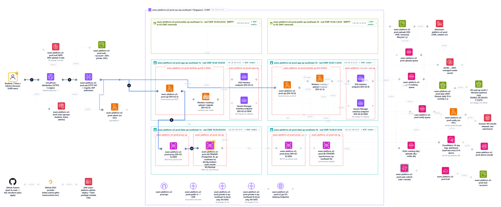
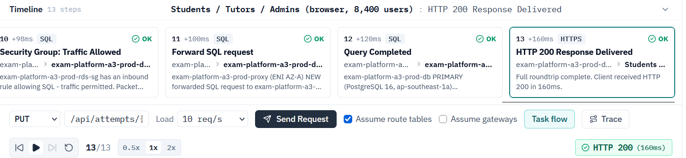
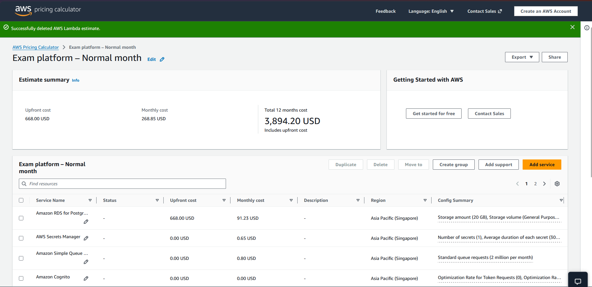
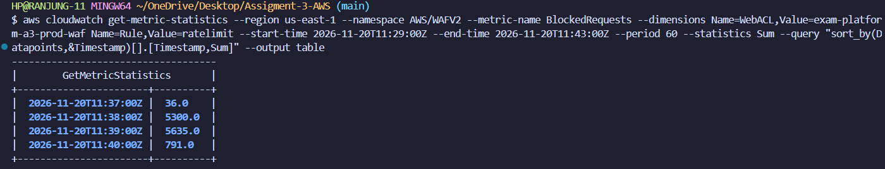
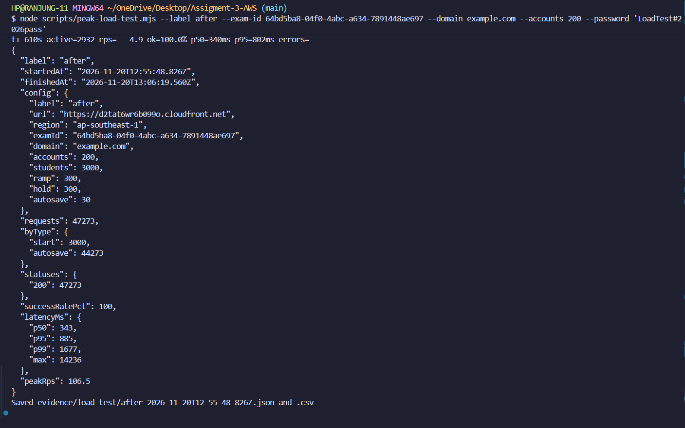
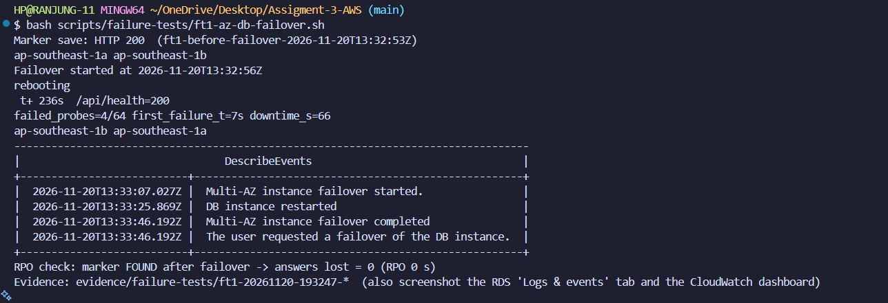
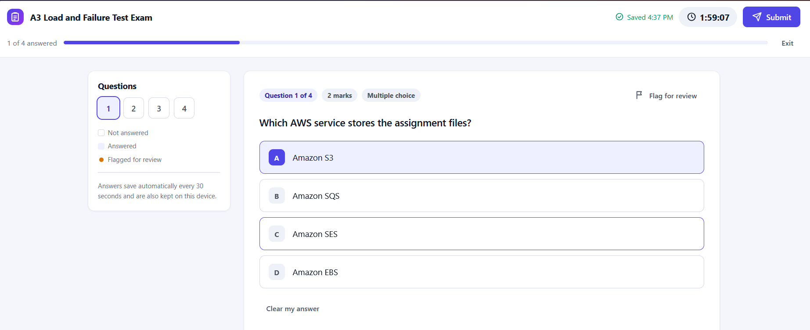

# Exam Platform on AWS: Cost, Resilience and Load Testing

**DSO303 Assignment 3** | Region: **ap-southeast-1 (Singapore)** | Builds on [Assignment 2](https://github.com/Rynorbu/DSO303-Assignment-02)

---

## Contents

1. [The task](#1-the-task)
2. [The answer in short](#2-the-answer-in-short)
3. [Architecture](#3-architecture)
4. [Cost](#4-cost)
5. [Load test: the exam peak](#5-load-test-the-exam-peak)
6. [Failure tests](#6-failure-tests)
7. [Why Singapore](#7-why-singapore)
8. [How the work was done](#8-how-the-work-was-done)
9. [Detailed reports and evidence](#9-detailed-reports-and-evidence)
10. [Deploy and tear down](#10-deploy-and-tear-down)
11. [Repository layout](#11-repository-layout)

---

## 1. The task

A university wants to run the online exam and assignment platform from Assignment 2 for **8,000 students and 400 staff** in the Singapore Region. Before it agrees, it needs answers to three questions.

| Question | Requirement |
|---|---|
| **Can we afford it?** | Stay within **USD 1,000 a month** |
| **Can it handle the busiest moment?** | In exam months, **3,000 students start one exam within 5 minutes** |
| **What happens when something breaks?** | Lose at most **5 minutes of data** (RPO), be back within **1 hour** (RTO), and keep running if **one Availability Zone** fails. Files must be kept for **5 years**. |

---

## 2. The answer in short

**Verdict: the platform is feasible.** It meets every requirement. The only risk left is losing the whole Singapore Region, which was not required and is accepted.

| Requirement | Target | Result | Status |
|---|---|---|---|
| Budget | at most $1,000 a month | **$359 a month** on average (36 % of the budget). The exam month is the most expensive, at $523. | Met |
| Exam peak | 3,000 starts in 5 minutes | **100 %** of 47,273 requests succeeded after the fix (only 68.5 % before it) | Met |
| Data loss (RPO) | at most 5 minutes | 0 s for an AZ failure, 154 s for corrupted data, 0 s for a deleted file | Met |
| Recovery time (RTO) | at most 1 hour | 66 s for an AZ failure, about 22 minutes for a database restore | Met |
| Lose one AZ | keep running | Tested twice: database failover and network loss | Met |
| Keep files 5 years | yes | S3 lifecycle rules and 5-year monthly backups | Met |
| Lose the whole Region | not required | Optional backup copy to Mumbai, recovery in 2 to 4 hours | Accepted risk |

**Key numbers**

| | |
|---|---|
| Cost per year | **$4,310** (the AWS Pricing Calculator confirms $4,286) |
| Cost per student | **$0.54 a year** |
| Saving compared with Assignment 2 | **$3,049 a year (42 % cheaper)** |
| Bottleneck found | The **WAF rate limit per IP address**, because a whole campus shares one IP |
| Latency from Bhutan | Singapore **145 ms**, compared with 364 ms for the Assignment 2 Region (N. Virginia) |

---

## 3. Architecture

**The revised architecture, drawn in the architecture-lab simulator**

**How a request travels:** student - CloudFront and WAF - API Gateway (sign-in checked with Cognito) - Lambda in two AZs - RDS Proxy - PostgreSQL database with a standby copy in the second AZ.

**The main changes from Assignment 2:**

| Change | Why |
|---|---|
| Moved from N. Virginia to **Singapore** | Required by the brief, and much faster from Bhutan (145 ms vs 364 ms) |
| **Removed both NAT gateways** and used private VPC endpoints instead | They were the second-biggest cost and were not needed. Saves $809 a year. |
| **Database sized by season:** `db.t4g.medium` normally, `db.t4g.large` in exam months, on a 1-year Reserved Instance | A large database all year was the biggest single cost. Saves $2,232 a year. |
| **RDS Proxy** in front of the database | The load test showed database connections running short |
| **WAF limit per student** instead of per IP address | The load test showed the old limit blocked a quarter of the exam traffic |
| **Logs kept 30 days** instead of 90, and an optional **backup copy to Mumbai** | Less cost and less personal data kept; protection if the Region is lost |

The simulator ran a student's autosave through this design: **13 steps, all passed, HTTP 200 in 160 ms.**

**Simulator run: the request reaches the database through RDS Proxy and returns successfully**

Full details, including all 14 changes and the single points of failure: [Architecture report](architecture/README.md)

---

## 4. Cost

| | Normal month | Exam month | Year |
|---|---:|---:|---:|
| **Final design** | $326.48 | $522.74 | **$4,310.28** |
| Assignment 2 design, moved to Singapore | $605.24 | $653.66 | $7,359.68 |

**The three most expensive parts**

| Rank | Part | Share of the bill | Why |
|---|---|---:|---|
| 1 | RDS database | 38 % | The only server running all the time, and Multi-AZ doubles its price for the standby |
| 2 | VPC endpoints | 11 % | The price of removing the NAT gateways, which is still cheaper than NAT |
| 3 | CloudFront | 10 % | Every request passes through it |

**Savings**

| Optimisation | Saving per year |
|---|---:|
| Remove the NAT gateways | $809 |
| Size the database by season | $1,789 |
| 1-year Reserved Instance for the database | $443 |
| Move old files to Glacier and Deep Archive (kept from Assignment 2) | $1,838 |
| Keep logs 30 days instead of 90 | $9 |

**AWS Pricing Calculator estimates** (Singapore, 2026-11-21)

| Link | Estimate | Calculator total | URL |
|---|---|---|---|
| **A** | Normal month (final design) | $268.85 a month + $668 upfront for the Reserved Instance | [https://calculator.aws/#/estimate?id=2f29a9ae440c858ad37fc479ff8bf410188e06a7](https://calculator.aws/#/estimate?id=2f29a9ae440c858ad37fc479ff8bf410188e06a7) |
| **B** | Exam month (final design) | $460.54 a month + $668 upfront | [https://calculator.aws/#/estimate?id=86c735058b92028b2a219a6d295a9dfaff85c899](https://calculator.aws/#/estimate?id=86c735058b92028b2a219a6d295a9dfaff85c899) |
| **C** | Assignment 2 design in Singapore (baseline for the savings) | $602.61 a month | [https://calculator.aws/#/estimate?id=9a4d1fa7e65a426b69d80ff1a5877bd410f49105](https://calculator.aws/#/estimate?id=9a4d1fa7e65a426b69d80ff1a5877bd410f49105) |

**Normal month in the AWS Pricing Calculator**

Full details, including hidden costs and five service comparisons: [Cost report](docs/cost-report.md)

---

## 5. Load test: the exam peak

3,000 virtual students started an exam over 5 minutes and then autosaved every 30 seconds, from a laptop in Bhutan against the real stack in Singapore.

| | Before the fix | After the fix |
|---|---:|---:|
| Requests that succeeded | 68.5 % | **100 %** |
| Requests blocked by WAF | 11,762 | **0** |
| Slowest 5 % of requests (p95) | 10.2 s | **0.9 s** |
| Database connections (peak) | 67 | **28** |

**What went wrong:** the WAF allowed 20,000 requests per 5 minutes from each IP address. All students on a campus share one IP address, so WAF blocked a quarter of the exam traffic. CloudWatch proved it: the number of WAF blocks matched the number of errors exactly, and the API itself showed zero errors.

**The fix:** limit each student instead of each IP address, and cap how many API Lambdas run at once so the small test database is not overloaded.

**Before the fix: WAF blocking requests during the exam peak (CloudWatch)**

**After the fix: every request succeeded**

Full details: [Load-test report](docs/load-test.md)

---

## 6. Failure tests

Five failures were caused on purpose and measured. A sixth (losing the whole Region) was worked through on paper.

| Test | What failed | Data lost (RPO) | Back in (RTO) | Result |
|---|---|---:|---:|---|
| FT1 | The AZ holding the main database | 0 s | 66 s | Pass |
| FT2 | Data wiped by a bad change (restore from backup) | 154 s | about 22 min | Pass |
| FT3 | The network of one AZ | 0 s | 120 s, recovered by itself | Pass |
| FT4 | A student's file deleted | 0 s | 73 s | Pass |
| FT5 | The marking worker stopped | 0 s | 96 s | Pass |
| FT6 | The whole Singapore Region (on paper) | up to 24 h | 2 to 4 h | Accepted risk |

**FT1: the database moved to the other AZ, and the saved answer was still there**

Full details, with expected and measured results and a fix for each test: [Failure-test report](infra/failure-tests/README.md)

---

## 7. Why Singapore

Latency was measured from Bhutan with 20 samples per Region.

| Region | Median latency | Cost per year |
|---|---:|---:|
| **Singapore** (chosen) | **145 ms** | $4,753 (before the Reserved Instance) |
| Hyderabad | 155 ms | not costed |
| Mumbai | 165 ms | $4,291 |
| N. Virginia (Assignment 2) | 364 ms | not costed |

Singapore is the fastest from Bhutan and is required by the brief. Mumbai is 10 % cheaper but slower, so it is used as the backup Region instead.

---

## 8. How the work was done

- **Built and tested for real.** The stack was deployed to Singapore with Terraform through GitHub Actions. All tests ran on 2026-11-20. The stack was then torn down, after about 5.4 hours, at an estimated cost of $1.41.
- **Screenshots instead of a video.** As agreed with the tutor, the evidence is screenshots plus raw test output.
- **Limits of the class account.** The account is on the AWS Free plan, which refused three things:
  - RDS Proxy;
  - database sizes above `db.t4g.micro`;
  - AWS Fault Injection Service.

  So the tests used the smallest database with a Lambda concurrency cap, and the network failure test used a network ACL instead. **The cost estimate is for the full production design**, with RDS Proxy and the larger database.

**The app running in Singapore: a student's answers are autosaved**

---

## 9. Detailed reports and evidence

| Report | What is in it |
|---|---|
| [Architecture](architecture/README.md) | The design, all changes from Assignment 2 and why, single points of failure, and the simulator run |
| [Cost report](docs/cost-report.md) | Cost of every service, hidden costs, five service comparisons, savings, the calculator check, and the verdict |
| [Load-test report](docs/load-test.md) | The exam-peak test: before, the cause proven with CloudWatch, the fix, after, and two more bottlenecks |
| [Failure-test report](infra/failure-tests/README.md) | Six failure scenarios, each with expected impact, measured results and a fix |
| [Evidence](evidence/README.md) | Every screenshot, plus the raw CSV and JSON output |

---

## 10. Deploy and tear down

The pipeline is the same as in Assignment 2:
1. run the bootstrap once;
2. set the GitHub variables;
3. push to `main`.

These variables are new for Assignment 3:

| Variable | Value | Purpose |
|---|---|---|
| `AWS_REGION` | `ap-southeast-1` | Singapore |
| `DB_INSTANCE_CLASS` | `db.t4g.medium`, or `db.t4g.large` in exam months | Size the database by season |
| `DB_USE_RDS_PROXY` | `true` on a paid account, `false` on the Free plan | Connection pooling |
| `API_RESERVED_CONCURRENCY` | `40`, only when there is no RDS Proxy | Protect a small database |
| `ENABLE_DR_BACKUP_COPY` | `true` (optional) | Copy backups to Mumbai |

---