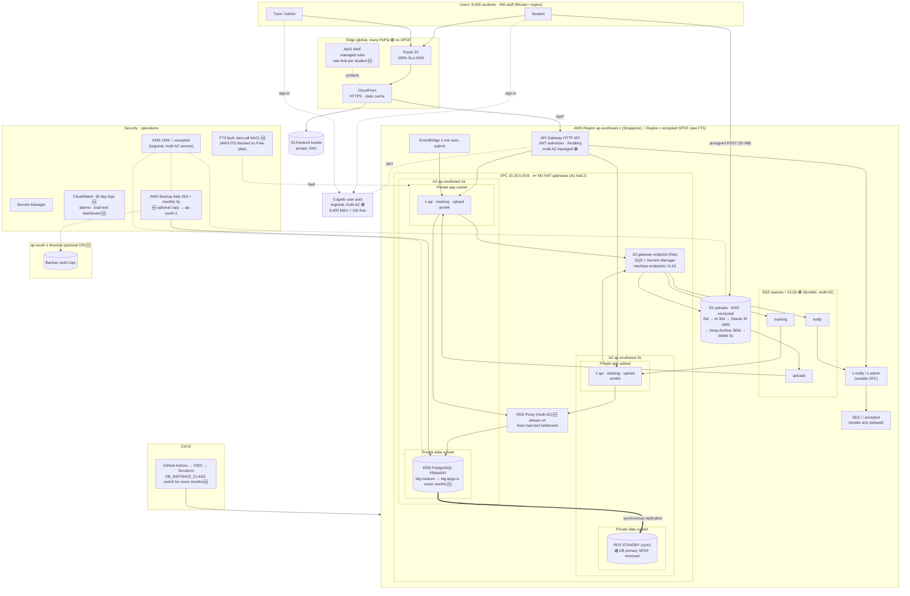

# Revised architecture (Assignment 3): cost-optimised, Singapore

**Region:** ap-southeast-1 (Singapore), across 2 Availability Zones.

**What changed from Assignment 2:** see [CHANGELOG.md](CHANGELOG.md). Every change is tied to a cost finding (`docs/cost-report.md`), a failure test (`infra/failure-tests/`) or the load test (`docs/load-test.md`).

**Diagram legend:**
- 🔴 **SPOF accepted**: a single point of failure kept on purpose, with the reason.
- 🟢 **SPOF removed**: a single point of failure the design eliminates.
- ✂️ **Removed for cost**: in Assignment 2, gone now.
- 🆕 **New in A3**

> Export a PNG for the submission: paste the block into <https://mermaid.live>, choose *Actions → PNG*, and save it as `architecture/architecture-a3.png`. Or redraw it in draw.io, keeping the same labels and SPOF markers.

## Single points of failure

| # | Component | Status | How it is handled | Evidence |
|---|---|---|---|---|
| 1 | RDS primary instance / its AZ | 🟢 removed | Multi-AZ synchronous standby. Automatic failover in about 1–2 min. RDS Proxy keeps client connections open. | FT1 |
| 2 | NAT gateway (A2 had one per AZ) | ✂️ removed entirely | Lambdas reach S3 through the gateway endpoint and SQS through an interface endpoint. RDS Proxy reads the DB secret through the Secrets Manager interface endpoint. Each interface endpoint has one ENI per AZ. | cost O1 |
| 3 | Lambda subnet in one AZ | 🟢 removed (with runbook) | Lambdas run in both AZs. Lambda does not health-check subnets, so a partial AZ network fault becomes a partial error rate. The runbook sets `lambda_subnet_indexes=[1]`. | FT3 |
| 4 | DB connection limit at peak (capacity SPOF) | 🟢 removed | RDS Proxy pools connections, and the instance is `t4g.large` in exam months. Free-plan alternative: `API_RESERVED_CONCURRENCY`. | load test |
| 5 | Logical corruption (affects the primary and standby together) | 🟢 mitigated | PITR (RPO ≤ 5 min) plus a rename-swap runbook. | FT2 |
| 6 | Single uploads bucket | 🟢 mitigated | S3 stores data in at least 3 AZs. Versioning protects against deletes. Noncurrent versions are kept 30 days (finding: raise to 90 days). | FT4 |
| 7 | Marking/notify worker | 🟢 mitigated | SQS keeps messages for 4 days, failures go to a DLQ, a DLQ alarm fires, and the DLQ can be redriven. | FT5 |
| 8 | Region ap-southeast-1 | 🔴 accepted | A warm standby would add about $150–300/month. The optional cross-Region backup copy gives RPO 24 h and RTO 2–4 h. | FT6 |
| 9 | SES (single Region) | 🔴 accepted | Emails are not critical. The notify queue holds them until SES returns. | — |
| 10 | KMS key (single, regional) | 🔴 accepted | KMS is a multi-AZ managed service. Deletion takes a 7-day waiting period, and key rotation is on. | — |
| 11 | WAF / CloudFront config in us-east-1 control plane | 🔴 accepted | Only the *control plane* lives in us-east-1. Serving keeps working from the edge. | — |
| 12 | CI/CD (GitHub) | 🔴 accepted | Not in the request path. Terraform can be run from a laptop with the same state bucket. | — |

## How the design handles the exam peak (after the A3 fixes)

1. Two days before an exam month, CI applies `DB_INSTANCE_CLASS=db.t4g.large`. Multi-AZ resizes the standby first, then fails over, so the downtime is about 1 minute and happens out of hours.
2. 3,000 starts in 5 minutes is about 10 req/s; autosaves are about 100 req/s. CloudFront and WAF absorb the static load.
3. API Gateway's throttles (burst 5,000) are far above that. Lambda scales out (with a quota of at least 1,000), and RDS Proxy multiplexes hundreds of Lambda connections onto a few dozen database connections.
4. Marking and emails go through SQS with capped consumer concurrency, so the database is never flooded.
5. After the exam month, the instance goes back to `t4g.medium`, which the 1-year Reserved Instance covers.
