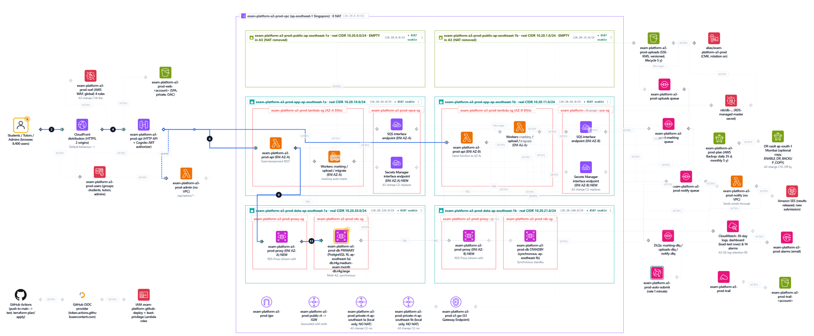
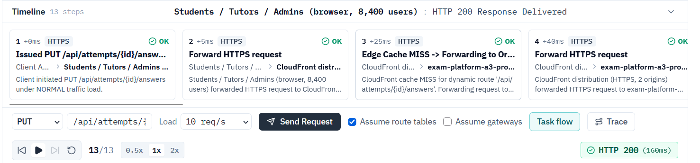
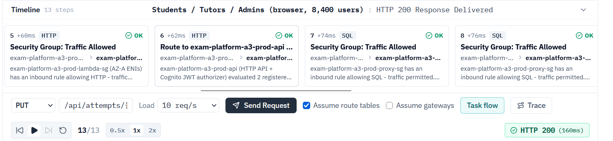
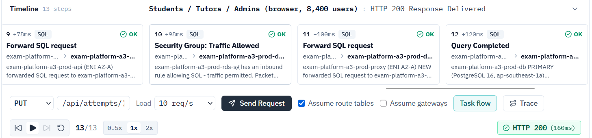
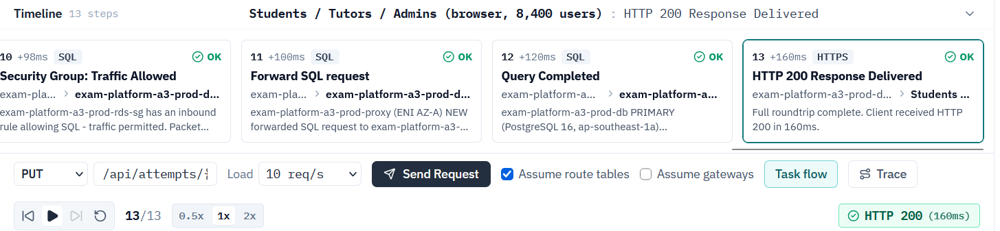

# Architecture: Revised for Cost and Resilience (Singapore)

**Region:** ap-southeast-1 (Singapore), across 2 Availability Zones (1a and 1b).

**Contents**
1. [The design](#1-the-design)
2. [How a request flows (simulator run)](#2-how-a-request-flows-simulator-run)
3. [What changed from Assignment 2, and why](#3-what-changed-from-assignment-2-and-why)
4. [Single points of failure](#4-single-points-of-failure)
5. [How the design handles the exam peak](#5-how-the-design-handles-the-exam-peak)

---

## 1. The design

*Drawn in the architecture-lab simulator used in Assignment 2. To open it there, import [`lab/a3-overall-architecture.json`](lab/a3-overall-architecture.json).*

| Layer | Services | What it does |
|---|---|---|
| **Edge** (global) | CloudFront, AWS WAF (4 rules), S3 web bucket | Serves the web app over HTTPS and filters bad traffic. WAF rate-limits **per student**, not per IP. |
| **Sign-in** | Cognito user pool | Students, tutors and admins sign in. API Gateway checks their JWT token. |
| **API** | API Gateway HTTP API - Lambda (Node 22, arm64) | Runs exams, autosave, submissions and uploads. Lambda runs in private subnets in **both AZs**. |
| **Database** | **RDS Proxy** - RDS PostgreSQL 16 **Multi-AZ** | The primary is in AZ 1a, with a synchronous standby in 1b. `db.t4g.medium` normally, `db.t4g.large` in exam months. The proxy pools connections. |
| **Private network** | VPC with **no NAT gateways**: S3 gateway endpoint, SQS and Secrets Manager interface endpoints | The private subnets have no internet route at all. They reach AWS services privately. |
| **Background work** | SQS queues + dead-letter queues, EventBridge (1-minute auto-submit), SES | Marking, upload processing and emails run asynchronously, so a slow worker never blocks a student. |
| **Files** | S3 uploads bucket (KMS, versioning, lifecycle) | Standard - Infrequent Access (30 days) - Glacier Instant Retrieval (180 days) - Deep Archive (1 year) - deleted after 5 years |
| **Protection and operations** | KMS, Secrets Manager, AWS Backup, CloudWatch, CloudTrail, SNS | Encryption, daily (35 days) and monthly (5 years) backups, an optional copy to Mumbai, a dashboard, alarms, and an audit log |
| **Delivery** | GitHub Actions - OIDC - Terraform | One-click deploy, exam-month resize and tear down |

---

## 2. How a request flows (simulator run)

The simulator ran a student autosave (`PUT /api/attempts/{id}/answers`) through the design. **All 13 steps passed, and the request returned HTTP 200 in 160 ms.** Every security group allowed only the traffic it should.

**Steps 1 to 4: Browser - CloudFront - API Gateway**

**Steps 5 to 8: Lambda security group, Lambda, proxy security group**

**Steps 9 to 12: Lambda - RDS Proxy - RDS security group - database**

**Step 13: HTTP 200 back to the student**

---

## 3. What changed from Assignment 2, and why

Every change comes from a finding in the cost report, the load test or a failure test.

| # | Area | Assignment 2 | Assignment 3 | Why | Effect |
|---|---|---|---|---|---|
| C1 | **Region** | us-east-1 (N. Virginia) | **ap-southeast-1 (Singapore)** | Required by the brief, and measured latency from Bhutan is **145 ms vs 364 ms** | Every price re-checked for Singapore |
| C2 | **NAT gateways** | 2 (one per AZ) | **0.** A Secrets Manager endpoint was added next to the SQS and S3 endpoints. | NATs were the 2nd biggest cost ($86/month) and carried nothing the endpoints cannot | **−$809 / year**, and one less SPOF |
| C3 | **Database size** | `db.m6g.large` all year | **`db.t4g.medium`**, **`db.t4g.large`** in the 2 exam months | Load test and cost: a large instance all year was the biggest single cost | **−$1,789 / year** |
| C4 | **Database pricing** | On-Demand | **1-year Reserved Instance**, partial upfront | The database runs 24/7 and is the #1 cost | **−$443 / year** |
| C5 | **Connection pooling** | RDS Proxy optional (off) | **RDS Proxy always on** | Load test: connections and memory ran short; FT1: faster failover | Peak survivable; failover takes seconds |
| C6 | **Logs** | Kept 90 days | Kept **30 days** | Logs are not needed after marking | Small saving, less personal data kept |
| C7 | **Monitoring** | Basic dashboard | Added Lambda throttles/concurrency/latency and RDS connections/memory/CPU credits | The bottleneck had to be proven with CloudWatch | Load-test evidence |
| C8 | **AZ evacuation** | Lambda subnets fixed | `lambda_subnet_indexes` variable | FT3: Lambda keeps using a subnet whose network is broken | A sick AZ can be removed in minutes |
| C9 | **Failure testing** | One failover script | **5 test scripts.** FT3 uses a deny-all network ACL because AWS FIS is blocked on this account. | At least 4 measured scenarios were needed | Repeatable tests |
| C10 | **Disaster recovery** | Backups in one Region | **Optional copy to Mumbai** (`ENABLE_DR_BACKUP_COPY`) | FT6: losing the Region would lose every backup | Region loss: RPO 24 h, RTO 2–4 h, about $3–5/month |
| C11 | **Backup note** | Monthly backups set to move to cold storage | Kept, but **noted as having no effect for RDS** | RDS snapshots cannot use cold storage | Costed honestly |
| C12 | **WAF rate limit** | 20,000 / 5 min **per IP** | **1,000 / 5 min per student**, plus 150,000 per IP as a flood backstop | Load test: WAF blocked 26 % of the peak, because a campus shares one IP | Peak no longer blocked; +$1/month |
| C13 | **Resource names** | `exam-platform-prod-*` | `exam-platform-a3-prod-*` | The first deploy clashed with another stack in the shared account | A3 deploys and tears down safely |
| C14 | **Deploy settings** | — | New GitHub variables: `DB_INSTANCE_CLASS`, `API_RESERVED_CONCURRENCY`, `ENABLE_DR_BACKUP_COPY`, `ENABLE_FIS` | Exam-month sizing must be a one-line change | Exam-month switch through CI |

**Kept from Assignment 2, because they are still the best choice** (see the comparisons in the [cost report](../docs/cost-report.md#5-service-choices-compared-with-alternatives)):
- **Lambda behind an HTTP API:** cheapest at this traffic level, with no idle servers, and it scales instantly.
- **RDS PostgreSQL Multi-AZ:** relational, cheaper than Aurora at a steady baseline, and it meets the RPO.
- **S3 lifecycle to Deep Archive:** saves about $1,838 a year compared with keeping everything in S3 Standard.
- **CloudFront + WAF, Cognito, SQS with DLQs, KMS, and Terraform through GitHub OIDC.**

---

## 4. Single points of failure

| # | Component | Status | How it is handled | Proof |
|---|---|---|---|---|
| 1 | Database primary or its AZ | removed | Multi-AZ synchronous standby with automatic failover. RDS Proxy holds client connections during it. | FT1: RTO 66 s, RPO 0 |
| 2 | NAT gateway | removed | No NAT at all. Private access goes through VPC endpoints with one network interface in each AZ. | Cost O1 |
| 3 | Lambda subnet in one AZ | removed | Lambda runs in both AZs. A sick AZ can be removed with `lambda_subnet_indexes = [1]`. | FT3: healed itself in 120 s |
| 4 | Database connections at peak | removed | RDS Proxy pools connections, and the instance is larger in exam months. Free-plan fallback: an API concurrency cap. | Load test: connections 67 → 28 |
| 5 | Bad change or corrupted data (hits primary and standby together) | mitigated | Point-in-time restore plus a rename-swap runbook | FT2: RPO 154 s, RTO ≈ 22 min |
| 6 | Uploads bucket | mitigated | S3 keeps data in 3+ AZs, and versioning undoes deletes | FT4: RTO 73 s, 0 bytes lost |
| 7 | Marking or email worker | mitigated | SQS holds messages for 4 days, with DLQs and alarms | FT5: drained in 96 s, 0 lost |
| 8 | **Singapore Region** | accepted | A warm standby would add $150–300/month. Optional backup copy to Mumbai instead. | FT6 tabletop |
| 9 | SES (email) | accepted | Emails are not critical. The queue holds them until SES is back. | — |
| 10 | KMS key | accepted | KMS is a multi-AZ managed service. Deletion has a 7-day waiting period. | — |
| 11 | WAF / CloudFront settings in us-east-1 | accepted | Only changing settings needs us-east-1. Serving keeps working from the edge. | — |
| 12 | GitHub (CI/CD) | accepted | Not in the request path. Terraform can also run from a laptop. | — |

---

## 5. How the design handles the exam peak

1. **Two days before an exam month,** CI sets `DB_INSTANCE_CLASS=db.t4g.large`. Multi-AZ resizes the standby first, then fails over, so the downtime is about 1 minute, out of hours.
2. **3,000 students start in 5 minutes.** That is about 10 starts a second, then about 100 autosaves a second. CloudFront and WAF take the static load, and the WAF limit is per student, so a shared campus IP is not blocked.
3. **API Gateway and Lambda** have far more capacity than that: the API Gateway burst limit is 5,000, and the Lambda quota is 1,000. **RDS Proxy** packs hundreds of Lambda connections onto a few dozen database connections.
4. **Marking and emails** go through SQS with limited worker concurrency, so the database is never flooded.
5. **After the exam month,** the database goes back to `db.t4g.medium`, which the Reserved Instance covers.
