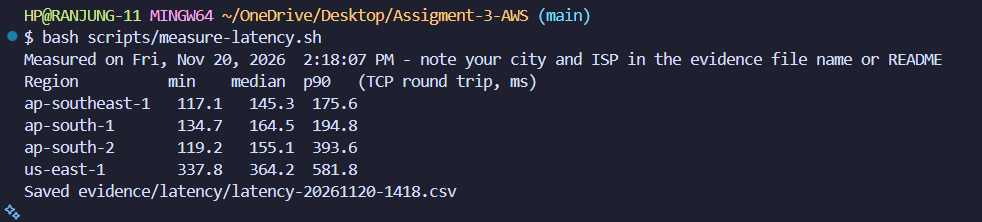
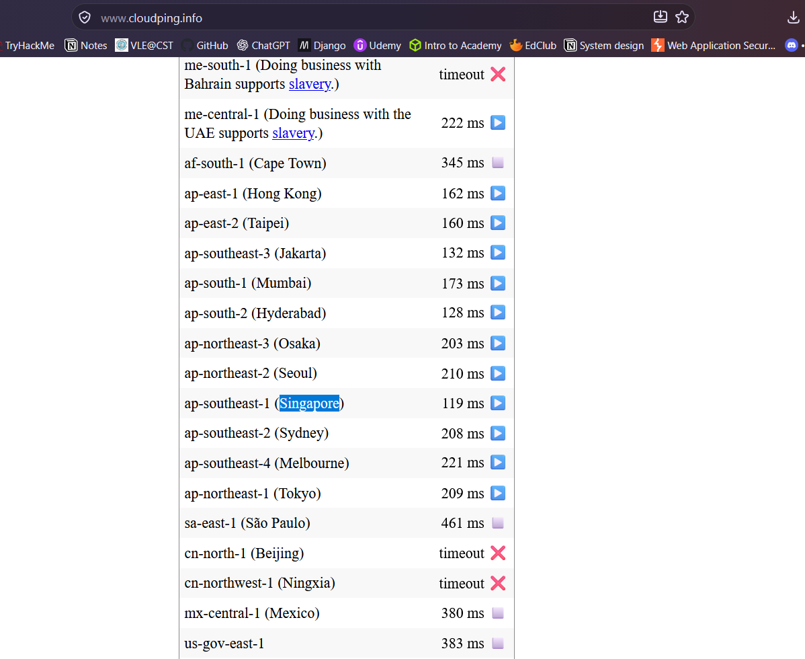
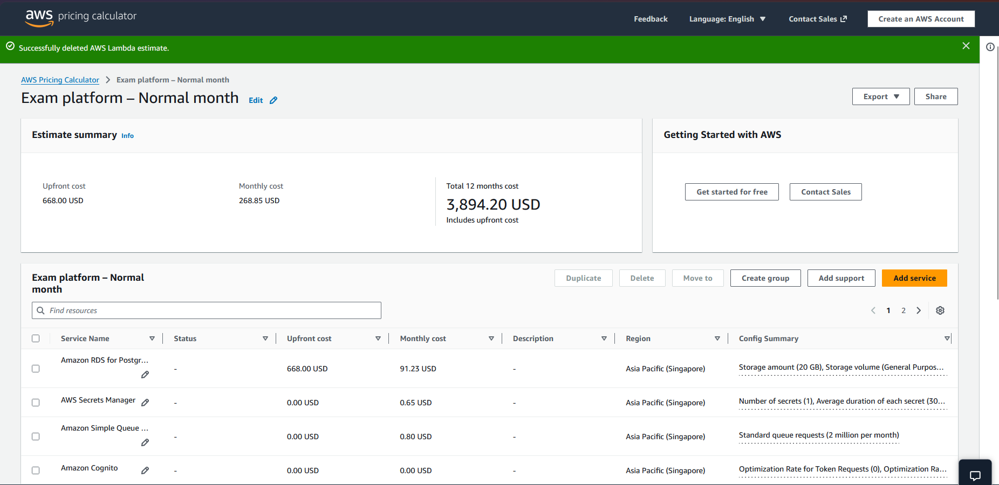
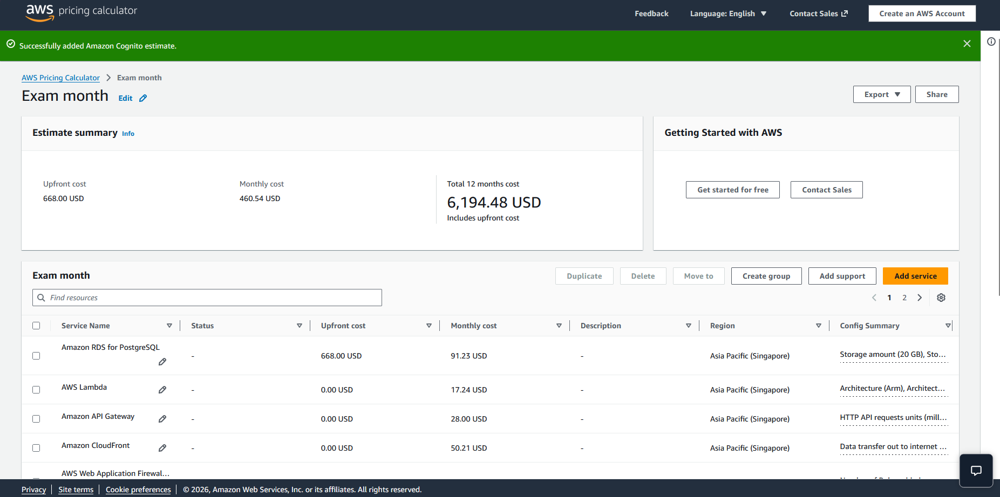
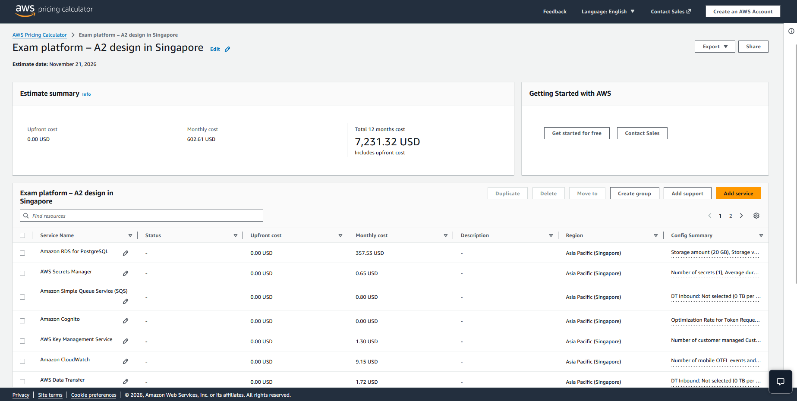
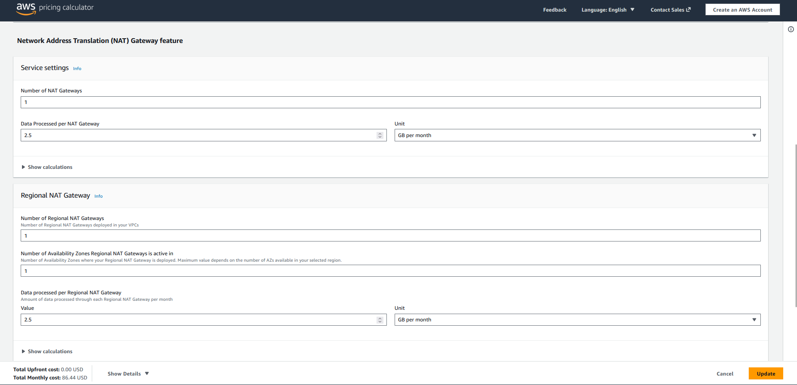
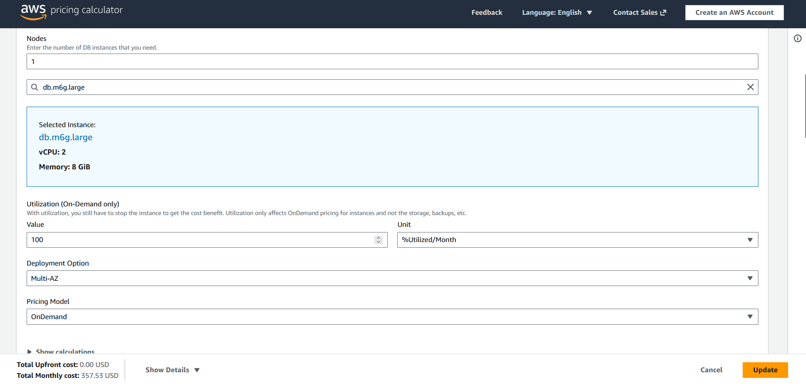
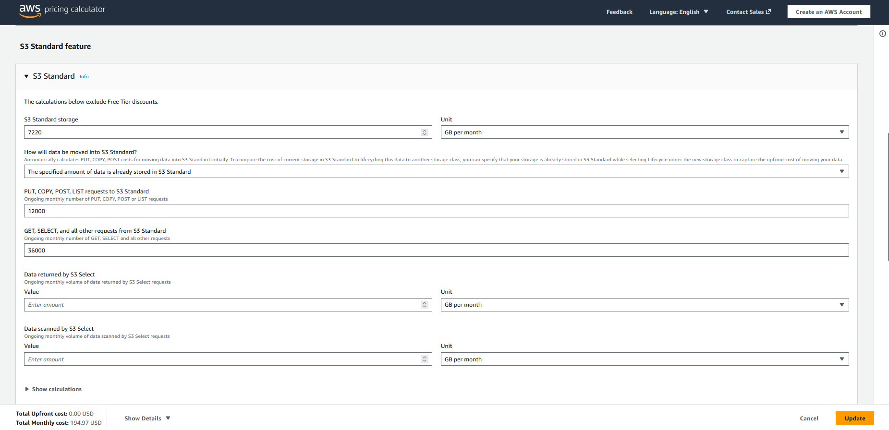

# Cost and Service Report (Singapore, ap-southeast-1)

**Contents**
1. [Summary](#1-summary)
2. [Assumptions](#2-assumptions)
3. [Monthly cost per service](#3-monthly-cost-per-service)
4. [Hidden costs and the three most expensive components](#4-hidden-costs-and-the-three-most-expensive-components)
5. [Service choices compared with alternatives](#5-service-choices-compared-with-alternatives)
6. [Singapore vs Mumbai, and latency from Bhutan](#6-singapore-vs-mumbai-and-latency-from-bhutan)
7. [Optimisations and their savings](#7-optimisations-and-their-savings)
8. [AWS Pricing Calculator check](#8-aws-pricing-calculator-check)
9. [Feasibility verdict](#9-feasibility-verdict)
10. [What the testing itself cost](#10-what-the-testing-itself-cost)

**Sources:**
- Prices from the AWS Price List API for `ap-southeast-1`, checked on **2026-11-19**, then confirmed in the AWS Pricing Calculator on 2026-11-21 (§8).
- Every number in this report can be regenerated with `node scripts/cost-model.mjs`.

---

## 1. Summary

| | Normal month | Exam month | Year (10 normal + 2 exam) |
|---|---:|---:|---:|
| **Final design** | **$326.48** | **$522.74** | **$4,310.28** |
| Assignment 2 design moved to Singapore | $605.24 | $653.66 | $7,359.68 |

- **Average $359 a month**, which is **36 % of the $1,000 budget**. Even the most expensive month (exam, $523) is far under the budget.
- **$0.54 per student per year.**
- The optimisations save **$3,049 a year (−42 %)** compared with the Assignment 2 design.
- **Cash flow:** the 1-year Reserved Instance needs **$668 upfront**. The monthly figures above already spread it over 12 months.

---

## 2. Assumptions

| Driver | Normal month | Exam month | Basis |
|---|---|---|---|
| Users | 8,400 monthly active (8,000 students + 400 staff) | same | brief |
| Concurrent users | 300 - 500 | peak of 3,000 starting within 5 min | brief |
| API requests | 14.4 million | 22.4 million | 400 users × 2 requests/min × 10 h × 30 days; exam months add 40,000 attempts × 200 requests |
| Lambda | 80 ms average, 512 MB, arm64 | same | Assignment 2 setting |
| Assignment uploads | 12,000 files (120 GB) | 4,000 files (40 GB) | 8,000 students × 1.5 files × 10 MB |
| Files stored after 5 years | 7.2 TB | — | Year-5 level is costed, to be safe |
| CloudFront data out | 122 GB | 187 GB | web app + 5 KB per API response |
| Tutor downloads (S3 - internet) | 120 GB | 60 GB | each file opened about once |
| Logs | 11 GB | 17 GB | API, Lambda and PostgreSQL logs |
| Emails | 36,000 | 50,000 | results + upload receipts |
| Database | `db.t4g.medium` Multi-AZ, 20 GB | `db.t4g.large` Multi-AZ | from the load test |

---

## 3. Monthly cost per service

| Service | Normal month | Exam month | Year |
|---|---:|---:|---:|
| RDS PostgreSQL Multi-AZ instance (Reserved `t4g.medium`; exam month adds On-Demand to make `t4g.large`) | $111.29 | $259.48 | $1,631.86 |
| RDS storage, 20 GB gp3 Multi-AZ | $5.52 | $5.52 | $66.24 |
| RDS Proxy (2 vCPU) | $26.28 | $26.28 | $315.36 |
| RDS CPU credits | $0.00 | $9.75 | $19.50 |
| Backups (≈ 40 GB of snapshots) | $3.80 | $3.80 | $45.60 |
| NAT gateways | **$0.00** | **$0.00** | $0.00 (was $1,037 in A2) |
| VPC interface endpoints: SQS + Secrets Manager, 2 AZs | $37.98 | $37.98 | $455.76 |
| Lambda (arm64) | $10.76 | $16.71 | $141.03 |
| API Gateway HTTP API | $18.00 | $28.00 | $236.00 |
| CloudFront | $33.13 | $51.20 | $433.70 |
| WAF (1 web ACL, 4 rules) | $18.24 | $23.38 | $229.21 |
| S3 storage (lifecycle, year-5 level) | $26.50 | $26.50 | $318.00 |
| S3 requests + lifecycle transitions | $1.03 | $0.34 | $11.03 |
| Data transfer out to the internet | $14.40 | $7.20 | $158.40 |
| Data transfer between AZs | $1.72 | $2.68 | $22.56 |
| CloudWatch Logs | $8.03 | $12.41 | $105.12 |
| CloudWatch alarms (14) + dashboard | $3.40 | $3.40 | $40.80 |
| KMS key + requests | $1.24 | $1.39 | $15.18 |
| Secrets Manager | $0.65 | $0.65 | $7.80 |
| SQS | $0.40 | $0.56 | $5.12 |
| SES email | $3.60 | $5.00 | $46.00 |
| Cognito (8,400 users, under the 10,000 free tier) | $0.00 | $0.00 | $0.00 |
| Route 53 hosted zone | $0.50 | $0.50 | $6.00 |
| EventBridge, CloudTrail (free tier) | $0.00 | $0.00 | $0.00 |
| **Total** | **$326.48** | **$522.74** | **$4,310.28** |

Without the Reserved Instance (all On-Demand) the year would be $4,753.08.

---

## 4. Hidden costs and the three most expensive components

### 4.1 Hidden costs

These are easy to miss because they do not appear as a "server". Together they are about 10 % of the bill.

| Hidden cost | Normal | Exam | Why it matters |
|---|---:|---:|---|
| Data transfer out | $14.40 | $7.20 | Tutors downloading files. The first 100 GB a month is free, so the real bill is lower. |
| CloudWatch Logs | $8.03 | $12.41 | Ingesting costs $0.70/GB, so log *volume* matters more than how long logs are kept. |
| T4g CPU credits | $0.00 | $9.75 | If the database runs above its baseline for hours, each extra vCPU-hour is charged. |
| Backups | $3.80 | $3.80 | RDS snapshots **cannot use cold storage**, so 5 years of monthly snapshots stay at the normal price. |
| Data transfer between AZs | $1.72 | $2.68 | Half of the Lambdas sit in the AZ without the database primary. |
| KMS requests | $1.24 | $1.39 | Kept low by the S3 bucket key. Without it, every file upload and download would be a KMS call. |
| NAT gateway | $0.00 | $0.00 | **Removed.** In the A2 design it would cost $86 a month in hours alone. |
| **Total hidden** | **$29.19** | **$37.23** | |

### 4.2 The three most expensive components

| Rank | Component | Year | Share | Why it is expensive |
|---|---|---:|---:|---|
| 1 | **RDS database instance** | $1,631.86 | 38 % | It is the only server that runs all the time. Multi-AZ **doubles** its price for the standby that lets the platform survive an AZ loss with no data loss. With the proxy, storage and backups, the database is **48 %** of the bill. |
| 2 | **VPC interface endpoints** | $455.76 | 11 % | The price of removing the NAT gateways. Each endpoint is billed per AZ, per hour, even with no traffic. They are still $67 a month cheaper than the NAT gateways. |
| 3 | **CloudFront** | $433.70 | 10 % | Every API call (15–23 million a month) passes through it, at $0.012 per 10,000 requests. It grows with use. |

---

## 5. Service choices compared with alternatives

All prices are for Singapore at the usage in §2.

### 5.1 Backend compute: Lambda vs ECS Fargate vs EC2

| | **Lambda + HTTP API** | ECS Fargate + load balancer | EC2 Auto Scaling + load balancer |
|---|---|---|---|
| Cost (normal / exam month) | **$29 / $45** | ≈ $63 / $82 | ≈ $60 / $70 |
| Performance | Scales in seconds. Cold starts of 0.5 - 1.5 s. | No cold starts, but scaling takes 1–2 min, so it must be scaled up before an exam | Scaling takes 2 - 4 min |
| Resilience | Runs in several AZs, no servers to fail | Tasks in 2 AZs with health checks | Same, plus operating-system patching |
| Effort | Lowest (the A2 code already runs) | Containers, task definitions, scaling rules | Images, patching, scaling rules |
| **Decision** | **Keep.** Cheapest at this traffic and handles the peak without planning. | Better only for steady, high traffic | Most work, no benefit |

### 5.2 Database: RDS Multi-AZ vs Aurora Serverless v2 vs DynamoDB

| | **RDS PostgreSQL Multi-AZ + Proxy** | Aurora Serverless v2 | DynamoDB |
|---|---|---|---|
| Cost (normal / exam month) | **$143 / $301** | ≈ $252 / $500 | ≈ $22 / $33 |
| Performance | Fixed size, so it is resized for exam months | Scales in seconds | Fast at any scale, no connection limit |
| Resilience | Standby in a 2nd AZ, failover ≈ 1 min | 6 copies across 3 AZs, failover < 30 s | 3 AZs built in |
| Effort | None (A2 schema) | Low (same PostgreSQL) | **High:** the relational schema must be redesigned |
| **Decision** | **Keep.** Cheapest relational option. | Costs more, because it runs 24/7 | Cheapest, but the rewrite is too big for now. **Next step:** move only autosave to DynamoDB. |

### 5.3 Private network access: NAT gateways vs VPC endpoints

| | 2 NAT gateways (A2) | 1 NAT gateway | **VPC endpoints only** |
|---|---|---|---|
| Cost per month | **$105.13** + $0.059/GB | $62.06 + $0.059/GB | **$37.98** + $0.01/GB (S3 endpoint is free) |
| Resilience | One per AZ | **Single point of failure:** if its AZ fails, the other AZ loses access | One network interface per AZ |
| Why it works | — | — | The Lambdas only call S3, SQS and the database, and the proxy only needs Secrets Manager. Nothing needs the internet. |
| Saving per year vs A2 | — | $517 | **$809** |

### 5.4 Paying for the database: On-Demand vs Reserved Instance vs Savings Plan

| `db.t4g.medium` Multi-AZ | Per month | Saving | Commitment |
|---|---:|---:|---|
| On-Demand | $148.19 | — | none |
| 1-year Reserved, no upfront | $117.17 | 21 % | 12 months |
| **1-year Reserved, partial upfront** | **$111.29** | **25 %** | $668 upfront. It also covers half of the exam-month `t4g.large`. |
| 1-year Reserved, all upfront | $108.25 | 27 % | $1,299 upfront for little extra saving |
| Compute Savings Plan | — | — | Does not apply to RDS. Lambda is only $141 a year, so it would save about $20. |

A 3-year term was rejected: the platform is new, and the database choice (§5.2) may change.

### 5.5 Keeping files for 5 years: S3 Standard vs Intelligent-Tiering vs lifecycle 

| | S3 Standard only | Intelligent-Tiering | **Lifecycle to Glacier / Deep Archive** |
|---|---:|---:|---:|
| Storage per month (7.2 TB) | $180.00 | ≈ $42.30 | **$26.50** |
| Opening an old file | instant | instant | instant for the first year; **≈ 12 h** after 1 year |
| Saving per year vs Standard | — | $1,652 | **$1,838** |

Files older than a year are rarely opened (only for appeals), so a 12-hour wait is acceptable.

---

## 6. Singapore vs Mumbai, and latency from Bhutan

| | **Singapore** | Mumbai |
|---|---|---|
| Cost per year (same design, On-Demand) | $4,753 | **$4,291** (10 % cheaper) |
| Price examples | Database $0.203/h · API $1.25 per million | $0.167/h · $1.05 per million |
| **Latency from Bhutan** (median of 20 samples) | **145 ms** (fastest) | 165 ms |
| Other Regions measured | Hyderabad 155 ms · N. Virginia (A2 Region) **364 ms** | |
| **Decision** | **Stay in Singapore.** Required by the brief, and the fastest from Bhutan. Traffic leaves Bhutan through India and reaches Singapore by subsea cable faster than the land route to Mumbai. | **Use as the backup (DR) Region:** cheaper, close, and in a different geography. |

Moving from N. Virginia to Singapore cuts every API round trip by about **220 ms**. Raw data: [`evidence/latency/`](../evidence/latency).

**Measured from Bhutan**

**cloudping.info**

---

## 7. Optimisations and their savings

| # | Optimisation | Before | After | **Saving per year** |
|---|---|---|---|---:|
| O1 | **Remove both NAT gateways**, use VPC endpoints | 2 NAT gateways ($86/month) | + Secrets Manager endpoint ($19/month) | **$809** |
| O2 | **Right-size the database by season** | `db.m6g.large` all year ($322/month) | `t4g.medium` normally, `t4g.large` in exam months | **$1,789** |
| O3 | **1-year Reserved Instance** for the database | On-Demand | Reserved, partial upfront | **$443** |
| O4 | **S3 lifecycle** to Glacier / Deep Archive | All S3 Standard ($180/month) | $26.50/month | **$1,838** |
| O5 | **Logs kept 30 days** instead of 90 | 90 days | 30 days | $9 (small; mainly keeps less student data) |
| | **A2 design → final design** (O1 + O2 + O3 + O5) | $7,360 / year | $4,310 / year | **$3,049 (−42 %)** |

O4 was already part of Assignment 2, so it is measured against the simple option of keeping everything in S3 Standard.

**Further options, not applied:**
- The CloudFront free tier or flat-rate plan: about −$350 a year.
- Autosave in DynamoDB: about −$1,500 a year, but it needs a code rewrite.

---

## 8. AWS Pricing Calculator check

Three estimates were built in the AWS Pricing Calculator to confirm the model. Exports (CSV, PDF, JSON) are in [`evidence/calculator/`](../evidence/calculator).

| Estimate | Calculator shows | Same basis as this report ¹ | This report | Difference |
|---|---|---:|---:|---:|
| [Normal month](https://calculator.aws/#/estimate?id=2f29a9ae440c858ad37fc479ff8bf410188e06a7) | $268.85/month + $668 upfront | **$324.52** | $326.48 | −$1.96 |
| [Exam month](https://calculator.aws/#/estimate?id=86c735058b92028b2a219a6d295a9dfaff85c899) | $460.54/month + $668 upfront | **$520.44** ² | $522.74 | −$2.30 |
| [A2 design in Singapore](https://calculator.aws/#/estimate?id=9a4d1fa7e65a426b69d80ff1a5877bd410f49105) | $602.61/month | **$602.61** | $605.24 | −$2.63 |
| **Year** | | **$4,286.08** | **$4,310.28** | **−0.6 %** |

1. The calculator shows the Reserved Instance as $668 upfront. This report spreads it over 12 months: + $55.67 a month.
2. Exam month: the calculator forced 20 GB of storage on the extra database line, which counts the disk twice (−$5.52). It also has no field for CPU credits, so they were added by hand (+$9.75).

The two agree within 0.6 %. This report uses the slightly higher model figure, to stay on the safe side.

**Normal month**

**Exam month**

**A2 design in Singapore**

**Each optimisation, checked in the calculator.** The optimisations were undone one at a time, starting from the normal month and working back to the A2 design:

| Step | What was changed | Monthly total | Saving |
|---|---|---:|---|
| Start | Final design, normal month | $268.85 + $668 upfront | — |
| O5 | Logs kept 90 days | $268.85 | Cannot be shown: the calculator always assumes 1-month retention |
| O3 | Reserved → On-Demand | $361.41, no upfront | **$442.72 / year** (12-month totals $3,894 → $4,337) |
| O2 | `t4g.medium` → `m6g.large` | $535.15 | **$173.74 / month** |
| O1 | 0 → 2 NAT gateways | **$602.61** (= A2 design) | **$67.46 / month = $809.52 / year** |
| O4 | Lifecycle → all S3 Standard | S3 line $42.14 → $194.97 | **$152.83 / month** |

**O1 NAT gateways back**

**O2 bigger database**

**O3 On-Demand**

**O4 all S3 Standard**

*Note on O1:* the calculator does not allow 0 "regional NAT gateways". The A2 design's 2 NAT gateways were therefore entered as 1 standard + 1 regional gateway in 1 AZ. They are billed at the same hourly price, so the total is the same.

---

## 9. Feasibility verdict

| Requirement | Target | Evidence | Result |
|---|---|---|---|
| **Budget** | ≤ $1,000 a month | $359 average, $523 in exam months | 64 % headroom |
| **Exam peak** | 3,000 starts in 5 min | Load test: 68.5 % success before the fix, **100 %** after (47,273 requests, p95 885 ms) | |
| **RPO** | ≤ 5 min | AZ loss 0 s (FT1) · data corruption 154 s (FT2) · files 0 s (FT4) · queues 0 s (FT5) | |
| **RTO** | ≤ 1 h | AZ loss 66 s (FT1) · restore ≈ 22 min (FT2) · AZ network 120 s (FT3) · file 73 s (FT4) · worker 96 s (FT5) | |
| Survive one AZ | yes | FT1, FT3 | |
| Keep files 5 years | yes | S3 lifecycle deletes after 1,825 days; monthly backups kept 1,825 days | |
| Lose the whole Region | not required | FT6 tabletop: RTO 2–4 h with the Mumbai backup copy | accepted risk |

**Verdict: FEASIBLE.** The platform costs about **$4,310 a year (≈ $0.54 per student)**, about a third of the budget. It meets the RPO and RTO for every AZ-level and data-level failure, and it handles the exam peak at 100 % success. The remaining risk, losing the whole Singapore Region, is accepted, with an optional backup copy to Mumbai for about $3–5 a month.

---

## 10. What the testing itself cost

The class account has no Billing access, so the cost of the test stack was calculated from how long it ran.

| | |
|---|---|
| Test setup | `db.t4g.micro` Multi-AZ, no NAT, no RDS Proxy |
| Running cost | ≈ **$0.13 an hour** (database $0.051, VPC endpoints $0.052, WAF $0.012, storage and other $0.015) |
| Usage cost | ≈ **$0.70** (about 95,000 test requests, Lambda, logs, the FT2 restored database) |
| Lifetime | Created 2026-11-20 09:46 UTC, destroyed 15:12 UTC = **5.4 hours** |
| **Total** | 5.4 h × $0.13 + $0.70 ≈ **$1.41** |
