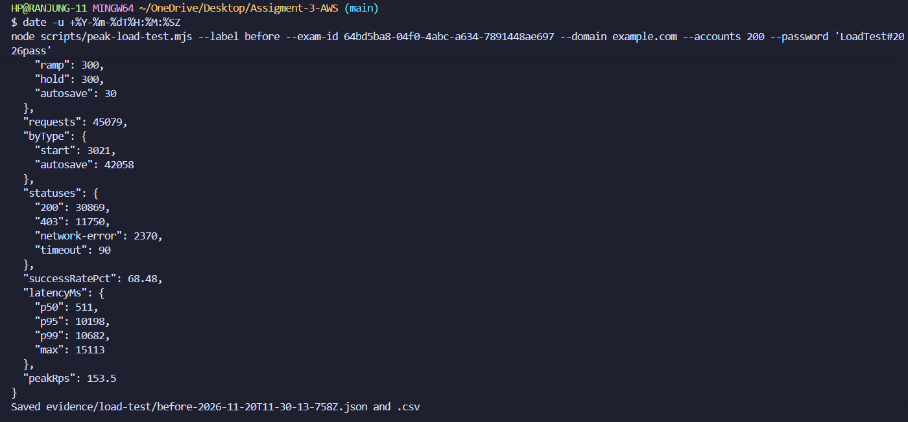
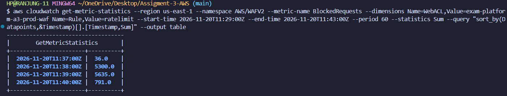
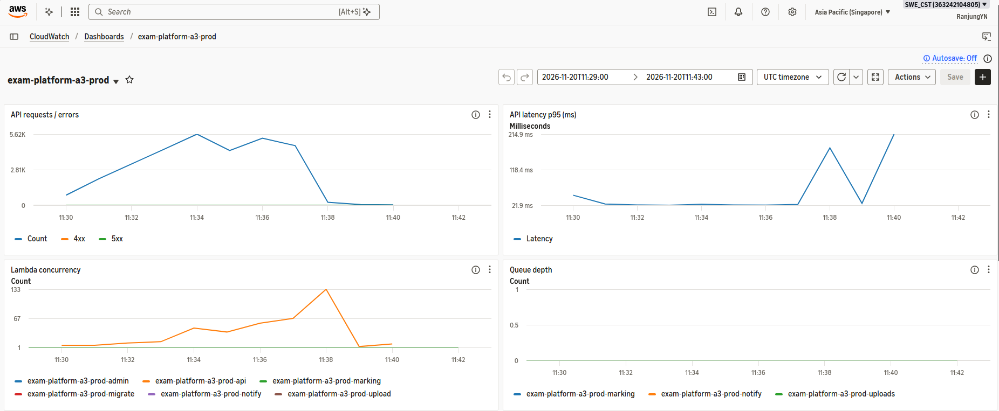
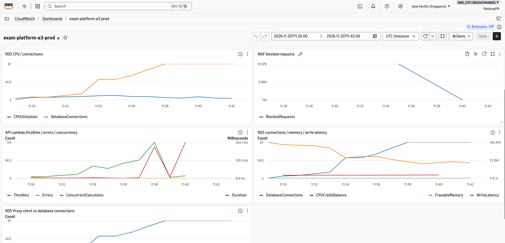
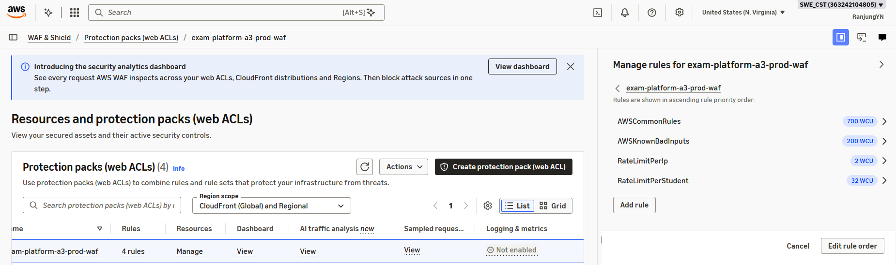
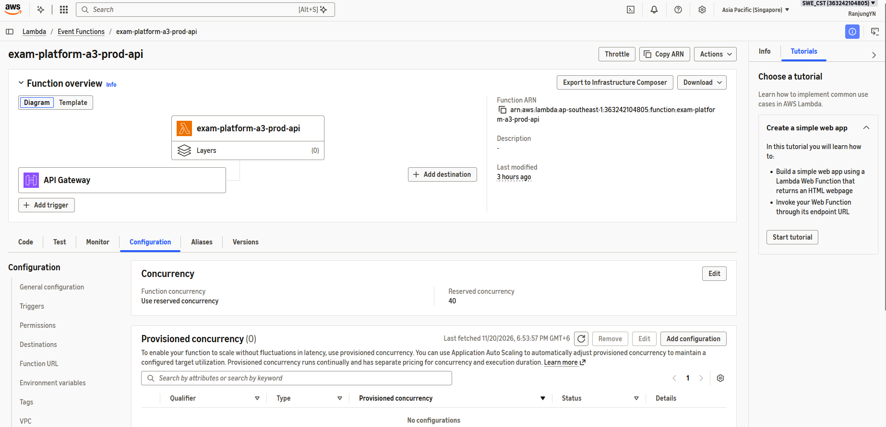
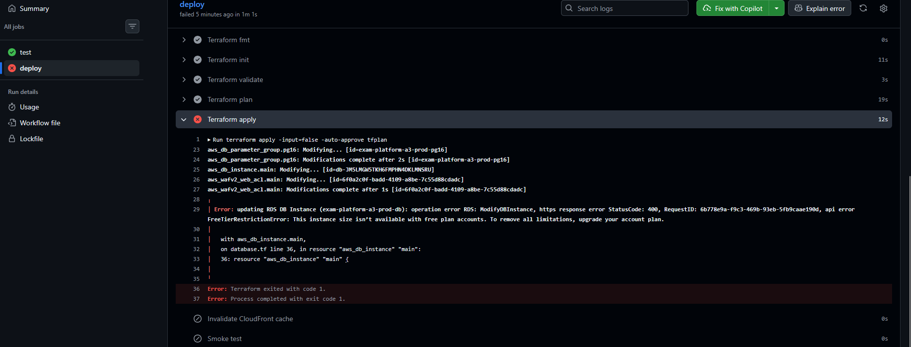
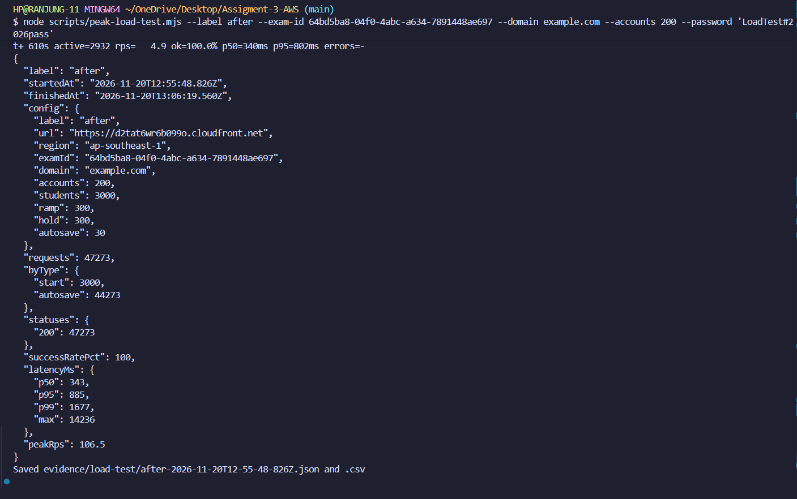
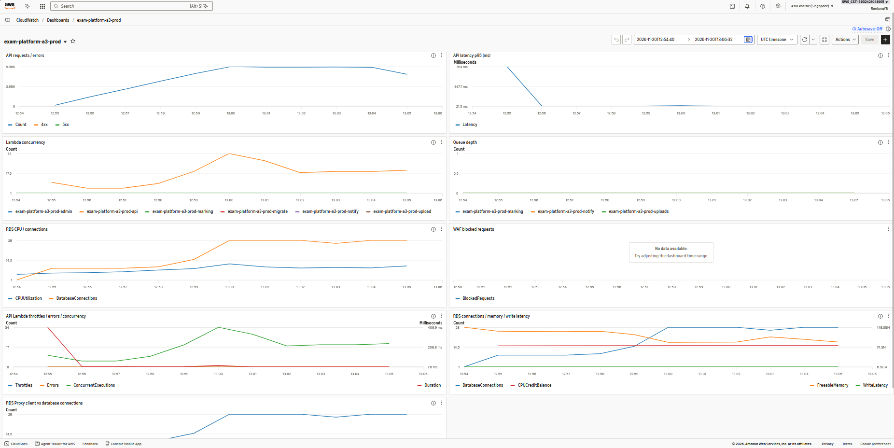

# Load Test: the Exam Peak

**Question:** Can the platform handle **3,000 students starting one exam within 5 minutes**?

**Answer:** Not at first: only **68.5 %** of requests succeeded. CloudWatch proved the cause was the **WAF rate limit per IP**. After the fix, **100 %** of requests succeeded.

**Contents**
1. [How the test was run](#1-how-the-test-was-run)
2. [Before: results](#2-before-results)
3. [The bottleneck, proven with CloudWatch](#3-the-bottleneck-proven-with-cloudwatch)
4. [The fix](#4-the-fix)
5. [After: re-test results](#5-after-re-test-results)
6. [Two more bottlenecks (reasoned)](#6-two-more-bottlenecks-reasoned)

---

## 1. How the test was run

| | |
|---|---|
| **Tool** | [`scripts/peak-load-test.mjs`](../scripts/peak-load-test.mjs), run from a laptop in Bhutan against the Singapore stack |
| **Traffic** | 3,000 virtual students start the exam over 300 s (**≈ 10 starts a second**). Each then autosaves every 30 s (**≈ 100 requests a second**), held for 5 more minutes. |
| **Accounts** | 200 Cognito test accounts shared by the 3,000 virtual students |
| **Measured with** | The script's own results, plus CloudWatch metrics exported with [`scripts/export-metrics.sh`](../scripts/export-metrics.sh) |
| **Lambda quota** | 1,000 concurrent executions, checked first, so it could not limit the test |

**Setup for the first run (Assignment 2 settings):** `db.t4g.micro`, no RDS Proxy, no API concurrency cap, and WAF allowing **20,000 requests per 5 minutes per IP**.

---

## 2. Before: results

Run on 2026-11-20, 11:30–11:41 UTC. Raw output: [`before-….json`](../evidence/load-test/before-2026-11-20T11-30-13-758Z.json).

| Measure | Value |
|---|---|
| Requests sent | 45,079 |
| Succeeded (HTTP 200) | 30,869 |
| **Blocked (HTTP 403)** | **11,750** |
| Network errors / timeouts | 2,370 / 90 |
| **Success rate** | **68.48 %** |
| Response time p50 / p95 | 511 ms / **10,198 ms** |

---

## 3. The bottleneck, proven with CloudWatch

### B1: the WAF rate limit per IP (proven)

| CloudWatch metric (same time window) | Value | What it shows |
|---|---|---|
| **WAF `BlockedRequests`, rule `RateLimitPerIp`** | **11,762** | Almost exactly the 11,750 HTTP 403s. **WAF blocked them.** |
| API Gateway 4xx / 5xx errors | **0 / 0** | The blocked requests never reached the API: they were stopped at the edge |
| API Gateway response time p95 | 215 ms | Requests that got through were served quickly |
| Lambda errors / throttles | 0 / 0 | Lambda was not the problem |

**WAF blocked requests**

**API Gateway: no errors**

**Why it happened:**
- The WAF rule allowed **20,000 requests per 5 minutes per IP address**.
- 3,000 students produce about **30,000 - 46,000 requests per 5 minutes**.
- In the test, all of them came from one IP. **A real campus is the same:** every student in a university lab shares one internet connection, and so one IP.
- So WAF blocked **26 % of all requests**. Students would see the exam fail to load and their autosaves fail.

### B2: database connections and memory (building up)

| CloudWatch metric | Value | What it shows |
|---|---|---|
| RDS `DatabaseConnections` (max) | **67** | Close to the ≈ 80 connections a `db.t4g.micro` can take |
| RDS `FreeableMemory` (min) | **57 MB** of 1 GB | Close to running out of memory |
| Lambda concurrency (max) | 133 | Without RDS Proxy, each Lambda holds its own connection |
| RDS CPU (max) | 10 % | CPU was not the limit |

Even with a quarter of the traffic blocked, the database was near its limits. Once WAF stopped blocking, about 33 % more traffic would reach it. **So B2 had to be fixed together with B1.**

---

## 4. The fix

| # | Change | Why |
|---|---|---|
| F1 | **WAF limit per student** instead of per IP: 1,000 requests per 5 minutes per sign-in token. The per-IP rule stays as a flood backstop at 150,000. | An abusive user is still blocked, but 3,000 honest students on one campus IP are not. Cost: +$1 a month for one more rule. |
| F2 | **Cap the API Lambda at 40 concurrent copies** (`API_RESERVED_CONCURRENCY=40`) | Each copy holds at most one database connection, so the cap keeps the connections under the limit. Extra requests get a quick "try again", and autosave retries 30 s later. |
| F3 (production) | **RDS Proxy** and **`db.t4g.large`** in exam months | The proper fix for B2: pooled connections and 8× the memory. **The class account could not do this.** The Free plan refused it with `FreeTierRestrictionError`, so F2 was used for the re-test. |

**WAF rules after the fix**

**API concurrency cap**

**Free plan refused a bigger database**

---

## 5. After: re-test results

Same test, run on 2026-11-20, 12:55–13:06 UTC. Raw output: [`after-….json`](../evidence/load-test/after-2026-11-20T12-55-48-826Z.json).

| Measure | Before | After | |
|---|---|---|---|
| Requests sent | 45,079 | 47,273 | the full peak |
| **Success rate** | 68.48 % | **100 %** | |
| Blocked by WAF | 11,762 | **0** | B1 removed |
| Network errors + timeouts | 2,460 | **0** | |
| Response time p50 / p95 | 511 / 10,198 ms | **343 / 885 ms** | p95 −91 % |
| Database connections (max) | 67 | **28** | B2 bounded |
| Database free memory (min) | 57 MB | **92 MB** | |
| Lambda concurrency (max) | 133 | **34** (cap 40) | |
| Lambda throttles / errors | 0 / 0 | **0 / 0** | the cap was never hit |

**After: script summary**

**After: dashboard**

**Conclusion:**
- **B1 is proven and fixed.** Blocked requests went from 11,762 to 0, and the success rate went from 68.5 % to **100 %**.
- **B2 is under control.** Database connections fell from 67 to 28, with more free memory and no throttling.
- The peak was met even on the smallest database the Free plan allows. Production adds RDS Proxy and `db.t4g.large` for about 10× more headroom.

All before/after screenshots side by side: [Evidence §6](../evidence/README.md#6-load-test).

---

## 6. Two more bottlenecks (reasoned)

These were not hit in the test, but they would appear at larger scale.

**B3: Lambda account limit.**
- The test peaked at 133 concurrent Lambdas. The account quota is **1,000**, so there is about 6× headroom.
- A new account with the default limit of 10 would have failed the very first exam.
- **Fix:**
  - check the quota before each exam month;
  - keep the Lambda `Throttles` alarm;
  - optionally pre-warm Lambdas (provisioned concurrency) for the hour around each exam start, at about $0.70 per exam.

**B4: Sending result emails (SES).**
- Releasing 3,000 results sends 3,000 emails.
  - In the SES sandbox (1 email a second) that takes **50 minutes**.
  - With production access (14 a second) it takes about 3.6 minutes.
- The notify queue holds the burst, so emails are delayed but never lost.
- **Fix:** request SES production access before the exam month.
- Cognito sign-in is fine: 3,000 sign-ins in 5 minutes is about 10 a second, far under its limit of about 120 a second.
