# Evidence

As agreed with the tutor, **screenshots replace the demo video**.

- Every AWS console screenshot was taken in **Asia Pacific (Singapore) `ap-southeast-1`**. The exception is WAF/CloudFront metrics, which AWS keeps in **us-east-1**.
- Machine-generated output (CSV/JSON) sits next to the screenshots.

**Contents:**
1. [Account and quotas](#1-account-and-quotas)
2. [Pricing Calculator](#2-pricing-calculator-costed-estimate)
3. [Latency from Bhutan](#3-latency-from-bhutan)
4. [Architecture](#4-architecture)
5. [Deployment in Singapore](#5-deployment-in-singapore)
6. [Load test](#6-load-test-bottleneck-proven-fixed-re-tested)
7. [Failure tests](#7-failure-tests)
8. [Actual cost and tear down](#8-actual-cost-and-tear-down)

---

## 1. Account and quotas

| AWS account | Region set to Singapore | Lambda concurrency quota (1,000) |
|---|---|---|
| 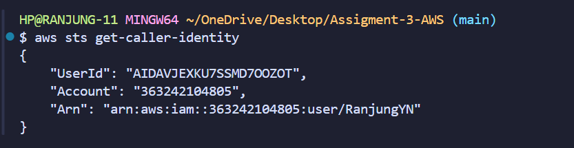 |  | 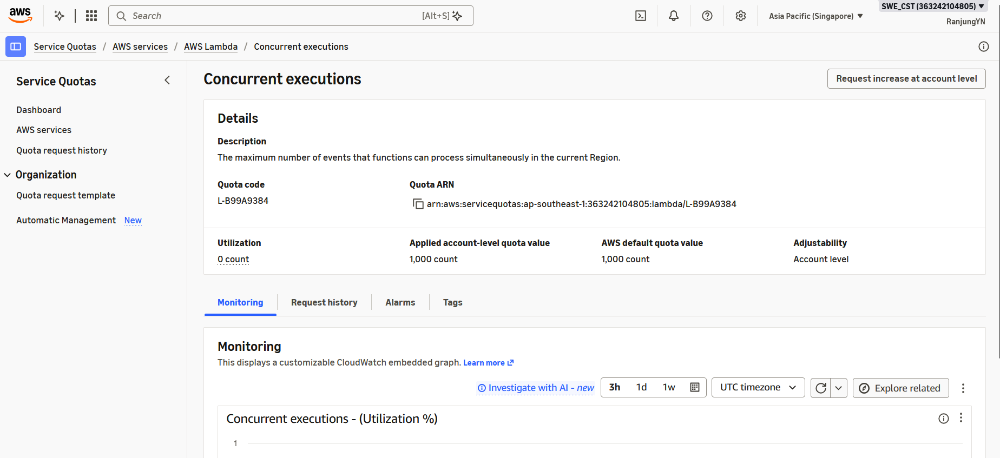 |

## 2. Pricing Calculator (costed estimate)

Share links: see the [README](../README.md#links). Exports:
- normal month: [`normal-month.csv`](calculator/normal-month.csv) · [`normal-month.pdf`](calculator/normal-month.pdf)
- exam month: [`exam-month.csv`](calculator/exam-month.csv) · [`exam-month.pdf`](calculator/exam-month.pdf)
- A2 baseline: [`a2-baseline.csv`](calculator/a2-baseline.csv) · [`a2-baseline.pdf`](calculator/a2-baseline.pdf)

| Normal month | Exam month | A2 design in Singapore (baseline) |
|---|---|---|
|  | 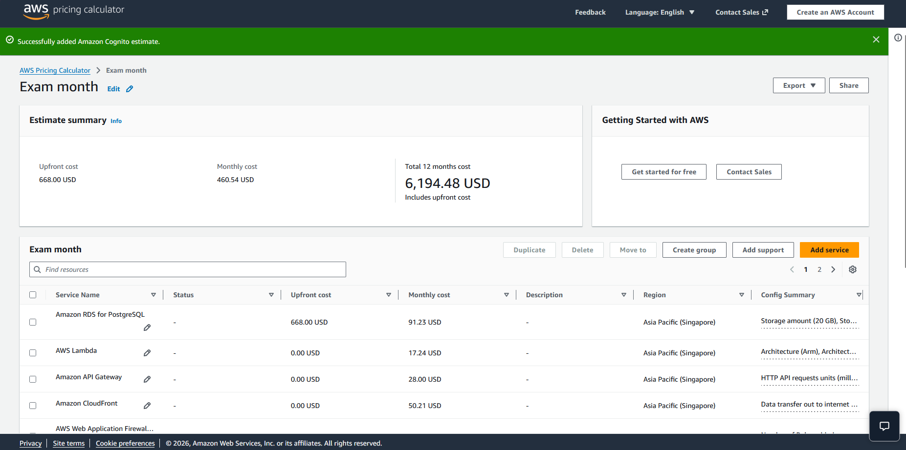 |  |

**Optimisations, applied one at a time** (saving = previous total − new total):

| O1 Remove NAT gateways | O2 Right-size the DB | O3 Reserved Instance |
|---|---|---|
|  | 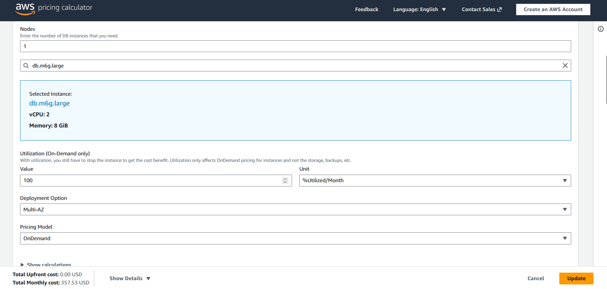 |  |

| O5 Log retention 30 days | O4 S3 Standard vs lifecycle |
|---|---|
|  |  |

## 3. Latency from Bhutan

Raw data: [`latency-20261120-1418.csv`](latency/latency-20261120-1418.csv). Medians: Singapore **145 ms** · Mumbai 165 ms · Hyderabad 155 ms · N. Virginia 364 ms.

| `measure-latency.sh` (20 samples per Region) | cloudping.info |
|---|---|
|  |  |

## 4. Architecture

**Revised, cost-optimised architecture with SPOF markers**

## 5. Deployment in Singapore

| Bootstrap outputs | GitHub variables | Pipeline green |
|---|---|---|
|  |  |  |

| Terraform init | Terraform apply log | Terraform outputs |
|---|---|---|
|  | 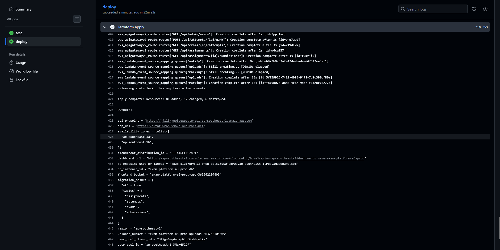 | 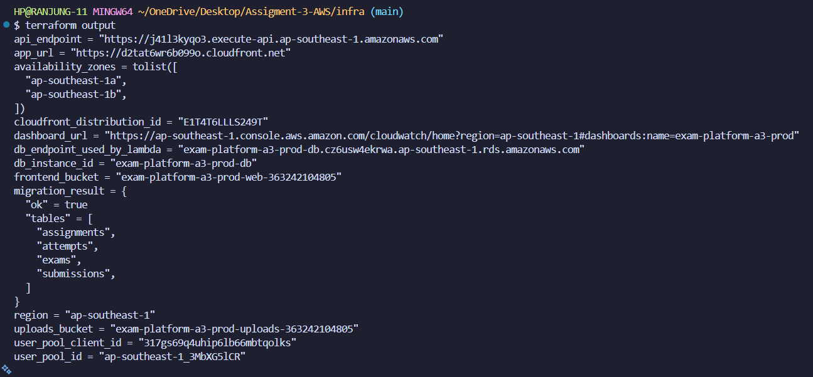 |

| No NAT gateways (O1) | VPC endpoints | Subnets in 2 AZs |
|---|---|---|
|  | 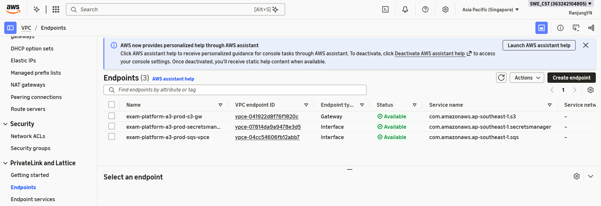 |  |

| RDS Multi-AZ | Lambda arm64 | S3 lifecycle (5 years) |
|---|---|---|
|  |  |  |

| Backup plan | Daily rule (35 days) | Monthly rule (5 years) |
|---|---|---|
|  |  | 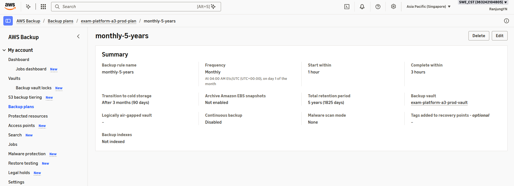 |

| CloudWatch dashboard | SNS subscription | Alarm email |
|---|---|---|
| 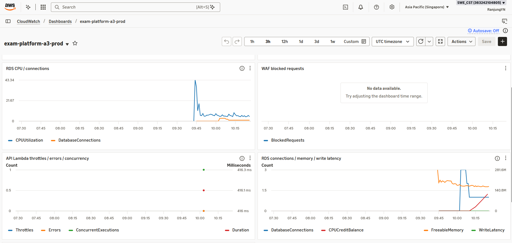 |  |  |

| Users created | Tutor created the exam | Student autosave | Answers kept after refresh |
|---|---|---|---|
|  |  |  | 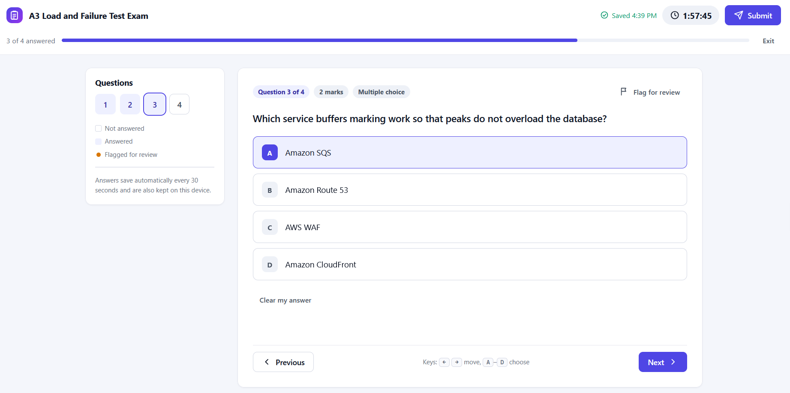 |

## 6. Load test: bottleneck proven, fixed, re-tested

Raw results: [`load-test/`](load-test) (script JSON + CSV) · [`cloudwatch/`](cloudwatch) (metric exports). Analysis: [`docs/load-test.md`](../docs/load-test.md).

| | **BEFORE** (A2 sizing; WAF 20,000 / 5 min per IP) | **AFTER** (fix applied) |
|---|---|---|
| Script summary |  |  |
| Whole dashboard | 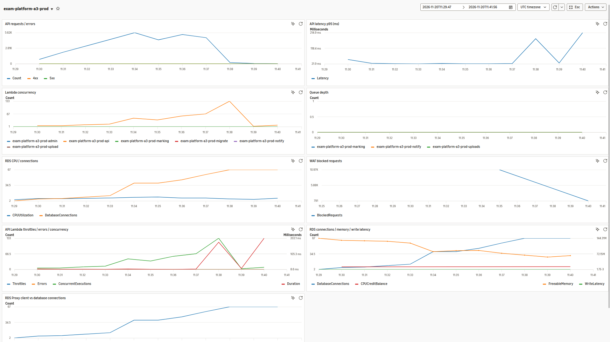 |  |
| RDS connections / memory + Lambda throttles / errors / concurrency |  | 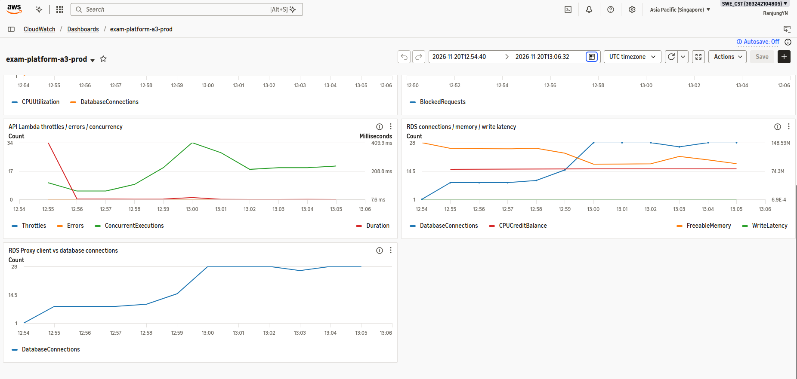 |
| API requests / errors | 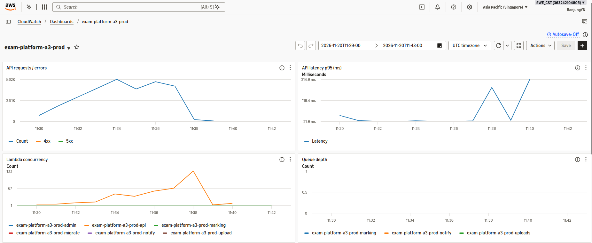 |  |
| WAF blocked requests (cause of the 403s) |  | 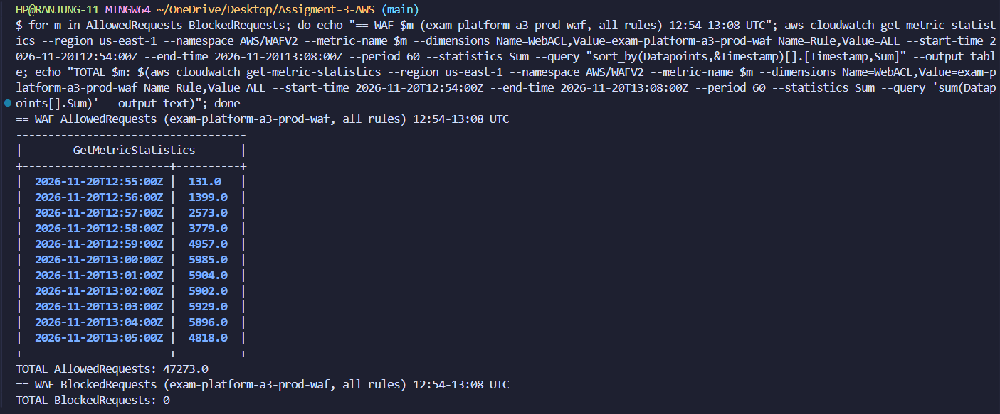 |

**The fix:**

| Variables changed | Free plan refused a bigger DB | WAF rules after the fix | API concurrency cap = 40 |
|---|---|---|---|
|  |  | 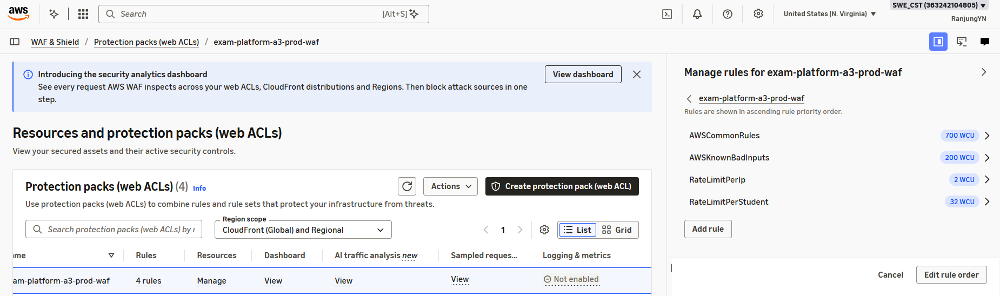 | 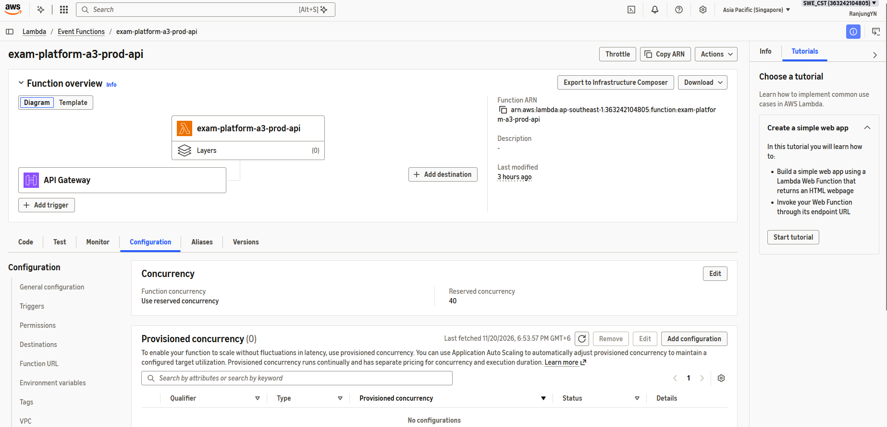 |

## 7. Failure tests

Scenarios, expected impact, measurements and fixes: [`infra/failure-tests/README.md`](../infra/failure-tests/README.md). Raw output: [`failure-tests/`](failure-tests).

**FT1: loss of the AZ that hosts the primary database**

| Primary AZ before | Downtime + RPO check | Primary AZ after | RDS failover events | Alarm email |
|---|---|---|---|---|
|  |  |  |  |  |

**FT2: point-in-time restore after logical data loss**

| RPO exposure | Restored instance | Restore time (RTO) |
|---|---|---|
| 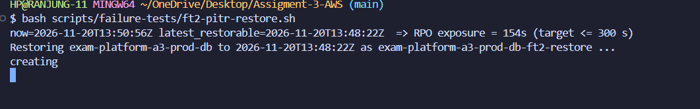 |  |  |

> The restored instance shows **Backing-up** because RDS starts the new instance's first automatic backup straight after the restore. Events: *Restored* at 13:58:08 → *Backing up* at 14:00:05 → *Finished backup* at 14:06:38, all shown in the RTO screenshot. The instance was already restored and usable. The script measured the moment it first became `available` (1,015 s).

**FT3: network loss in one AZ (deny-all network ACL; AWS FIS is blocked on the Free plan)**

| Deny-all ACL on the AZ-a subnet | Probe results | Errors on the dashboard |
|---|---|---|
|  |  |  |

**FT4: deleted assignment file**

| S3 versions + delete marker | Recovered, checksum identical |
|---|---|
| 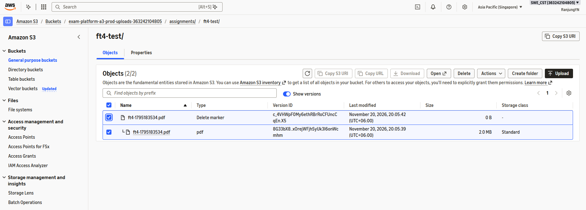 |  |

**FT5: marking worker outage**

| Worker stopped (concurrency 0) | Backlog drained in 96 s, DLQ 0 | Queue depth rises to 50, then drains |
|---|---|---|
| 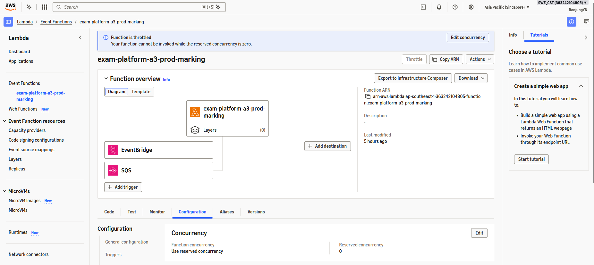 |  |  |

> No DLQ alarm fired: the DLQ depth stayed 0, so no message was lost or needed a redrive.

## 8. Actual cost and tear down

| Tear-down workflow | Nothing left |
|---|---|
|  | 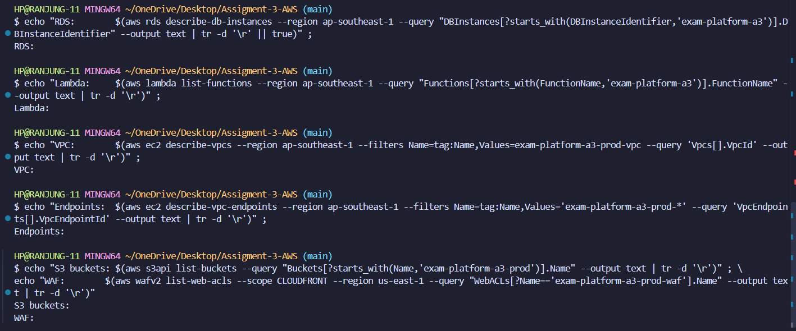 |

> Cost Explorer was not available: the shared class account gives students no Billing access. The cost of the test stack is estimated from its run time instead, in `docs/cost-report.md` §8.
