# Evidence

- Every AWS console screenshot was taken in **Asia Pacific (Singapore)**. The exception is the WAF metrics, which AWS keeps in us-east-1.
- The raw output (CSV, JSON, text) sits next to the screenshots in each folder.

**Contents**
1. [Account and quotas](#1-account-and-quotas)
2. [Pricing Calculator](#2-pricing-calculator)
3. [Latency from Bhutan](#3-latency-from-bhutan)
4. [Architecture](#4-architecture)
5. [Deployment in Singapore](#5-deployment-in-singapore)
6. [Load test](#6-load-test)
7. [Failure tests](#7-failure-tests)
8. [Tear down](#8-tear-down)

---

## 1. Account and quotas

**AWS account**

The AWS account used for the whole assignment.

**Region set to Singapore**

The console is set to Asia Pacific (Singapore), `ap-southeast-1`, the Region required by the brief.

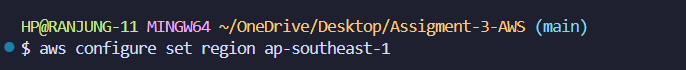

**Lambda concurrency quota: 1,000**

The account can run 1,000 Lambda functions at once. This was checked before the load test, so the quota could not be the bottleneck.

---

## 2. Pricing Calculator

Three estimates were built in the AWS Pricing Calculator. They are explained in the [cost report §8](../docs/cost-report.md#8-aws-pricing-calculator-check).

| Link | Estimate | Calculator total | Share link | Exports |
|---|---|---|---|---|
| **A** | Normal month (final design) | $268.85 a month + $668 upfront | [https://calculator.aws/#/estimate?id=2f29a9ae440c858ad37fc479ff8bf410188e06a7](https://calculator.aws/#/estimate?id=2f29a9ae440c858ad37fc479ff8bf410188e06a7) | [csv](calculator/normal-month.csv) · [pdf](calculator/normal-month.pdf) · [json](calculator/normal-month.json) |
| **B** | Exam month (final design) | $460.54 a month + $668 upfront | [https://calculator.aws/#/estimate?id=86c735058b92028b2a219a6d295a9dfaff85c899](https://calculator.aws/#/estimate?id=86c735058b92028b2a219a6d295a9dfaff85c899) | [csv](calculator/exam-month.csv) · [pdf](calculator/exam-month.pdf) · [json](calculator/exam-month.json) |
| **C** | Assignment 2 design in Singapore (baseline) | $602.61 a month | [https://calculator.aws/#/estimate?id=9a4d1fa7e65a426b69d80ff1a5877bd410f49105](https://calculator.aws/#/estimate?id=9a4d1fa7e65a426b69d80ff1a5877bd410f49105) | [csv](calculator/a2-baseline.csv) · [pdf](calculator/a2-baseline.pdf) · [json](calculator/a2-baseline.json) |

**A: Normal month**

The final design in a normal month. The $668 upfront is the 1-year Reserved Instance for the database.

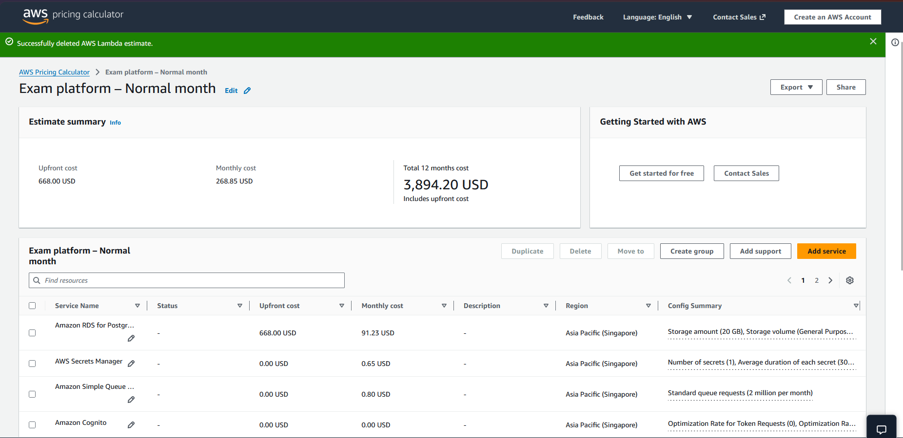

**B: Exam month**

The same design in an exam month. It costs more because the database is bigger and traffic is higher.

**C: Assignment 2 design in Singapore**

The Assignment 2 design priced in Singapore, with NAT gateways, a large database all year and no Reserved Instance. This is the baseline the savings are measured against.

### Optimisation steps

Starting from estimate A, each optimisation was undone one at a time. The increase in the total is the saving.

**O1: NAT gateways put back (+$67.46 a month)**

Adding back the two NAT gateways from Assignment 2. Removing them saves $809 a year.

**O2: database changed to `db.m6g.large` (+$173.74 a month)**

Going back to the large Assignment 2 database. Sizing the database by season saves $1,789 a year.

**O3: Reserved Instance changed to On-Demand (+$442.72 a year)**

Paying On-Demand instead of using a 1-year Reserved Instance for the database.

**O4: all files in S3 Standard (+$152.83 a month)**

Keeping all 7.2 TB of files in S3 Standard instead of moving old files to Glacier and Deep Archive.

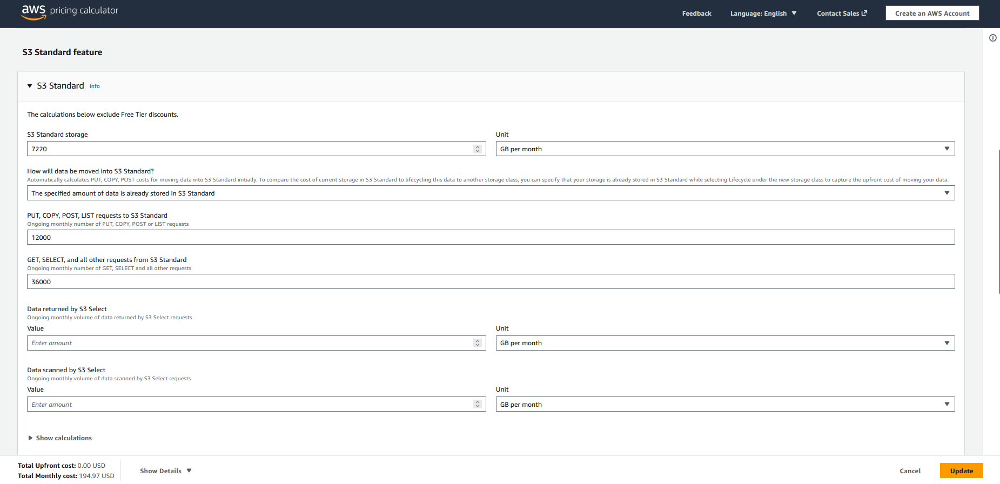

**O5: log retention**

The calculator always assumes logs are kept for one month, so the change from 90 to 30 days cannot be shown here. The saving is small (about $9 a year).

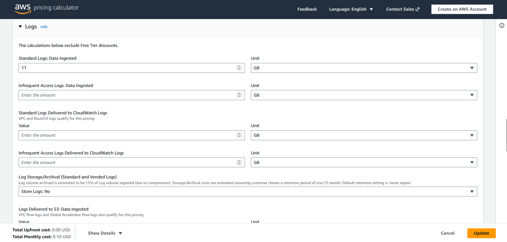

---

## 3. Latency from Bhutan

Measured from a laptop in Bhutan, 20 samples per Region. Raw data: [`latency-20261120-1418.csv`](latency/latency-20261120-1418.csv).

**Latency script output**

Median round-trip time: Singapore **145 ms**, Hyderabad 155 ms, Mumbai 165 ms, N. Virginia 364 ms. Singapore is the fastest.

**cloudping.info, from the same connection**

A second, independent check that agrees with the script.

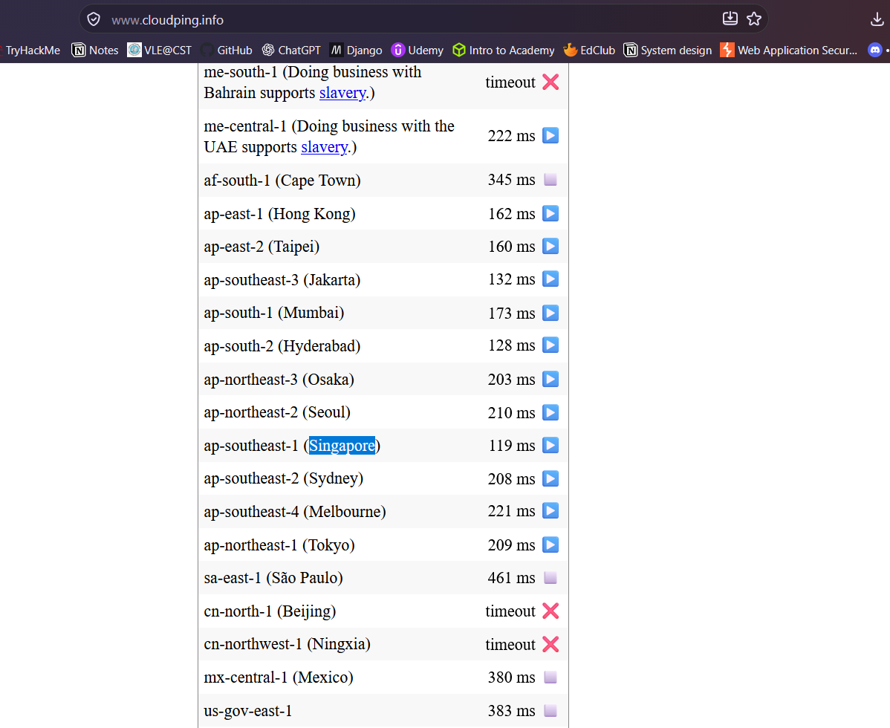

---

## 4. Architecture

**The revised architecture**

The final design in the architecture-lab simulator. It runs in Singapore across two AZs, with no NAT gateways, RDS Proxy in front of a Multi-AZ database, and private VPC endpoints.

The simulator then sent a student autosave through the design. All 13 steps passed, and the request returned **HTTP 200 in 160 ms**.

**Steps 1 to 4**

The request goes from the browser through CloudFront to API Gateway.

**Steps 5 to 8**

The security groups allow the request into the Lambda function, then on to RDS Proxy.

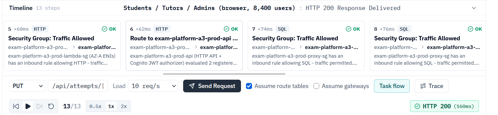

**Steps 9 to 12**

Lambda sends the query to RDS Proxy, which passes it to the database. The database security group only accepts the proxy.

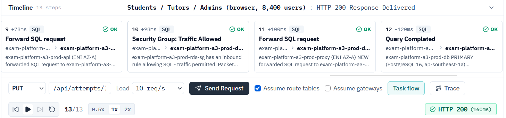

**Step 13**

The response returns to the student: HTTP 200 in 160 ms.

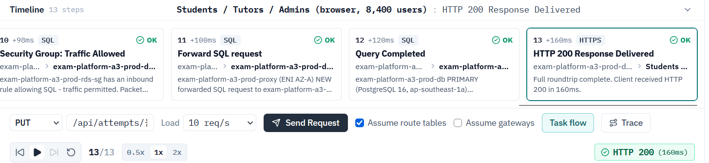

---

## 5. Deployment in Singapore

### Pipeline

**Bootstrap**

The one-time setup: the Terraform state bucket and the GitHub deploy role.

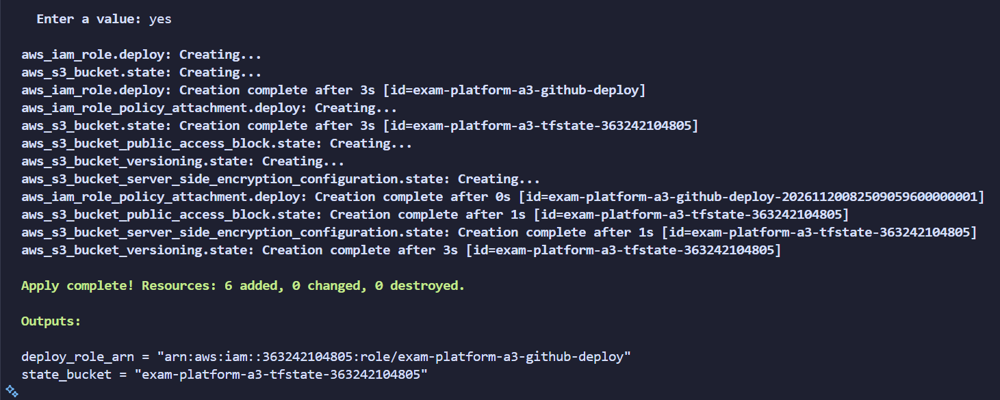

**GitHub variables**

The settings the pipeline uses, including the Singapore Region and the database size.

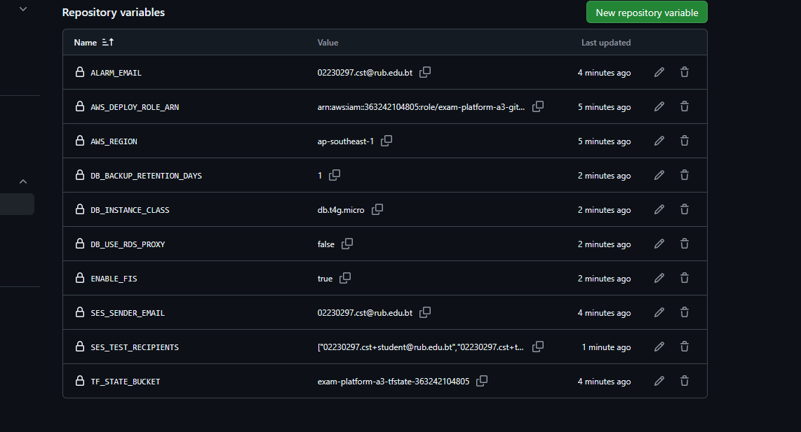

**Pipeline succeeded**

The GitHub Actions deploy finished successfully.

**Terraform init**

Terraform connected to its state bucket.

**Terraform apply**

Terraform created the resources in Singapore.

**Terraform outputs**

The app address and resource names after the deploy.

### Network

**No NAT gateways**

The VPC has no NAT gateways. This is optimisation O1.

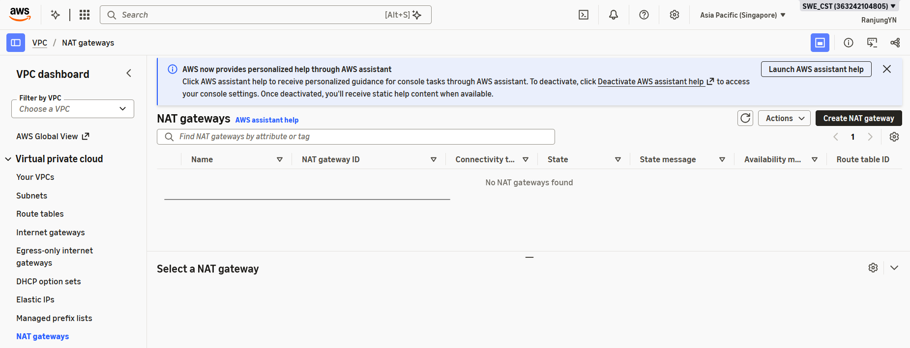

**VPC endpoints**

The private endpoints that replace the NAT gateways: S3, SQS and Secrets Manager.

**Subnets in two AZs**

Public, app and data subnets in both `ap-southeast-1a` and `ap-southeast-1b`.

### Compute, database and storage

**RDS Multi-AZ**

The database has a standby copy in the second AZ, so it survives the loss of one AZ.

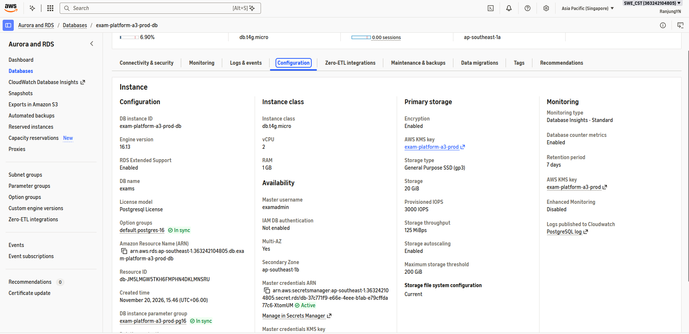

**Lambda on arm64**

The functions run on arm64 (Graviton), which is cheaper than x86.

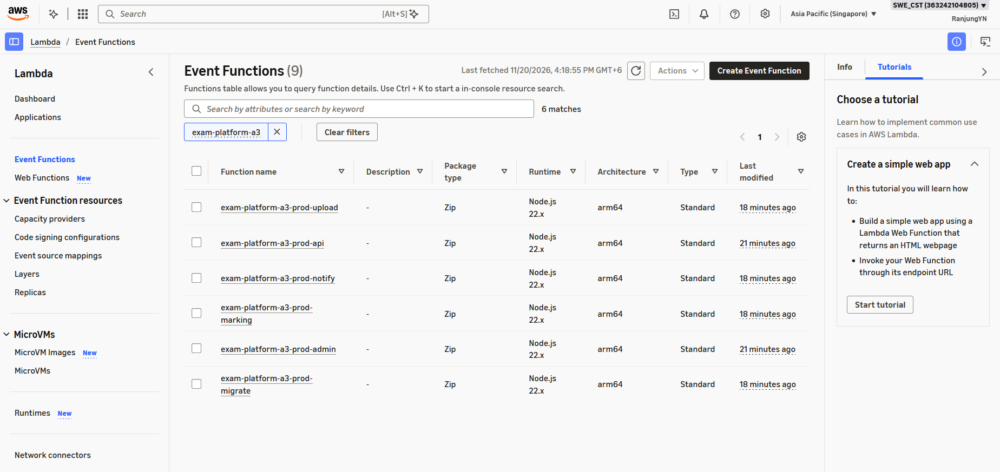

**S3 lifecycle (5 years)**

Files move to cheaper storage over time and are deleted after 5 years, as the brief requires.

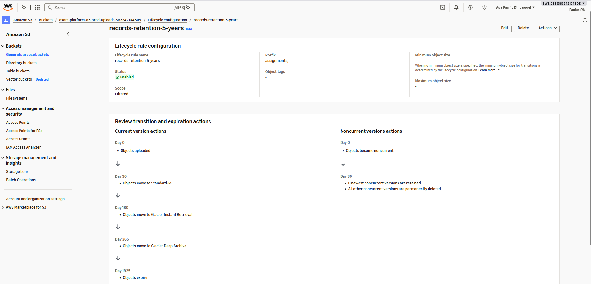

### Backups

**Backup plan**

AWS Backup protects the database.

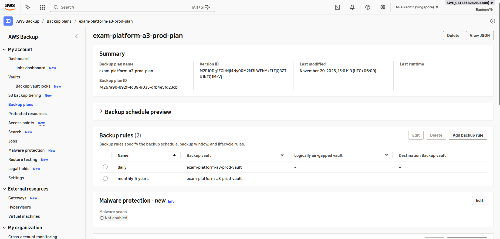

**Daily rule: kept 35 days**

One backup every day, kept for 35 days.

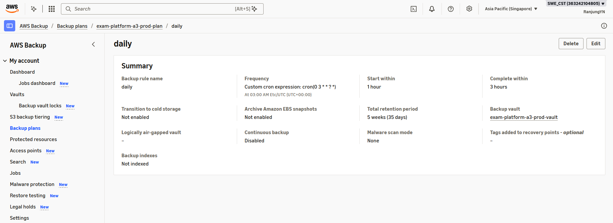

**Monthly rule: kept 5 years**

One backup every month, kept for 5 years.

### Monitoring

**CloudWatch dashboard**

The dashboard used to watch Lambda, API Gateway and the database. It was also used to prove the load-test bottleneck.

**Alarm subscription**

Alarm emails are confirmed for the team address.

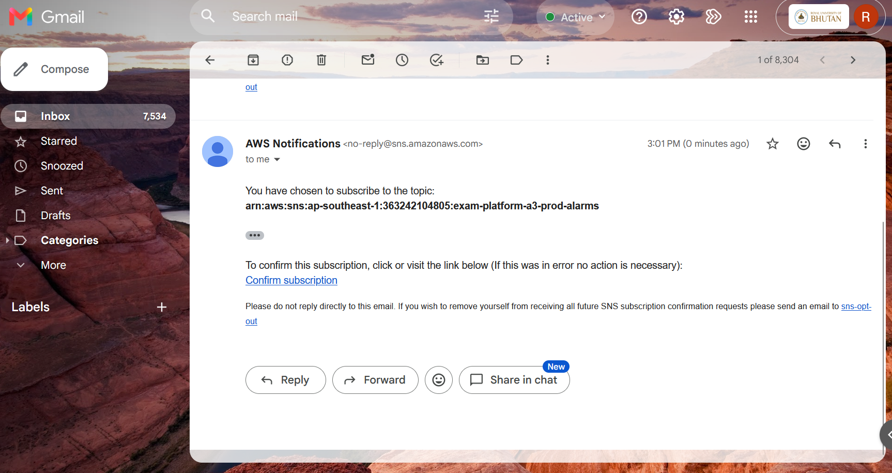

**Alarm email**

An alarm email arriving, which shows that alerting works.

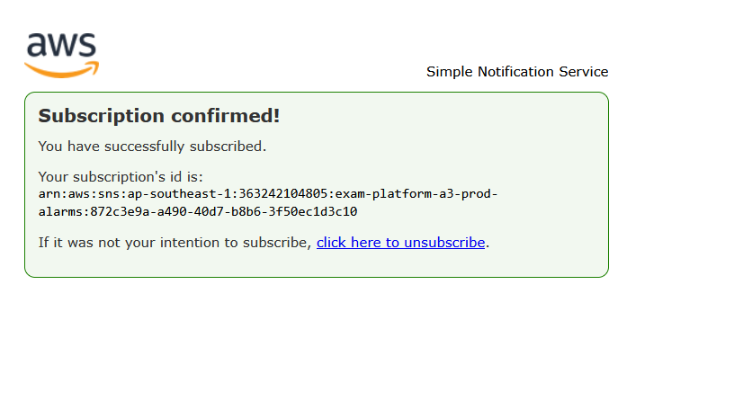

### The app working

**Users created**

Test student and tutor accounts in Cognito.

**Tutor created an exam**

A tutor creates and schedules an exam in the app.

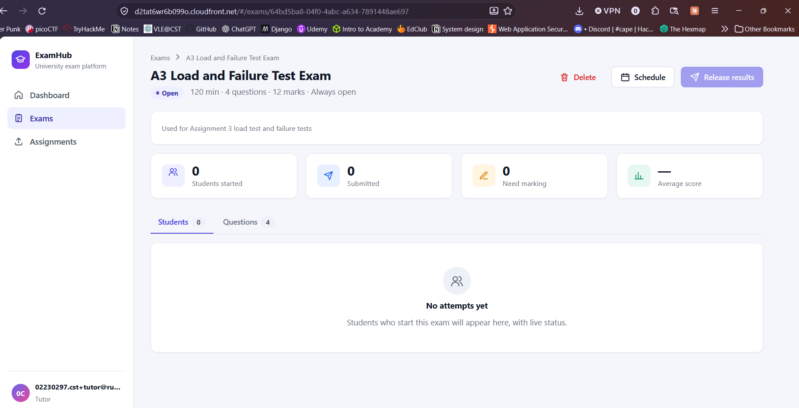

**Student autosave**

A student answers questions, and the answers are saved automatically.

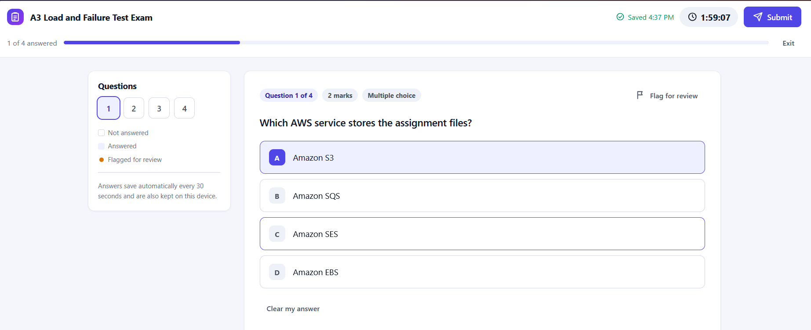

**Answers kept after a refresh**

After the page is reloaded, the saved answers are still there.

---

## 6. Load test

3,000 virtual students started an exam within 5 minutes. Full explanation: [load-test report](../docs/load-test.md). Raw output: [`load-test/`](load-test) and [`cloudwatch/`](cloudwatch).

### Before the fix (WAF limit: 20,000 requests per IP)

**Script result**

Only 68.5 % of requests succeeded, and 11,750 were refused with HTTP 403.

**Dashboard**

The whole CloudWatch dashboard during the test.

**Database and Lambda**

The database reached 67 connections and dropped to 57 MB of free memory, close to its limits.

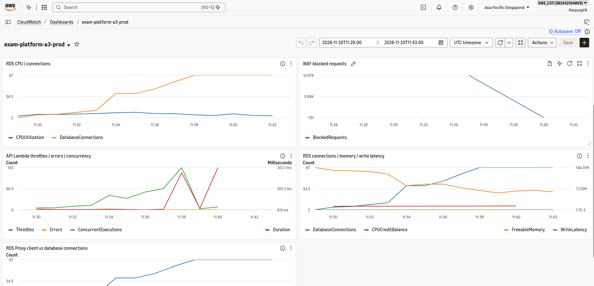

**API requests and errors**

API Gateway shows zero errors. The failing requests never reached the API.

**WAF blocked requests: the proof**

WAF blocked 11,762 requests, almost exactly the number of 403 errors. This proves the WAF per-IP limit was the bottleneck.

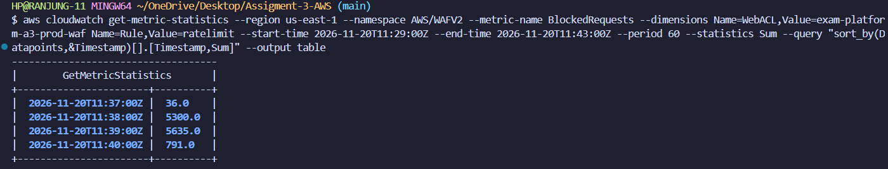

### The fix

**Variables changed**

The GitHub variables changed for the fix.

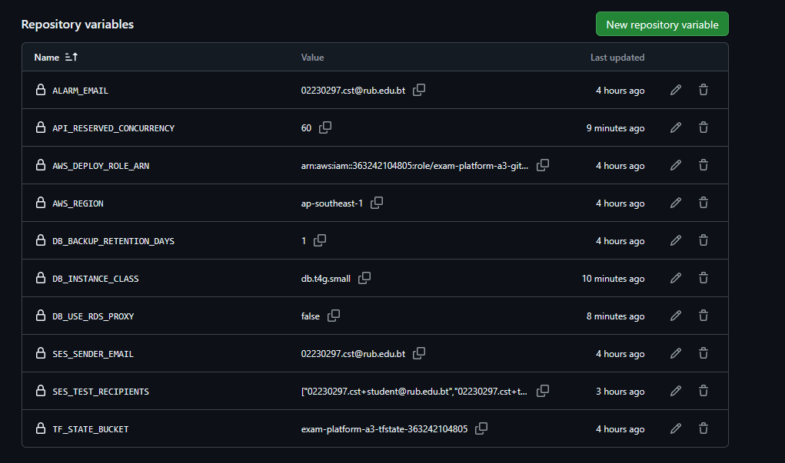

**Free plan refused a bigger database**

The class account refused a larger database (`FreeTierRestrictionError`), so the fix had to work on the smallest one.

**WAF rules after the fix**

A new rule limits each student instead of each IP address. The per-IP limit was raised to 150,000 as a backstop against floods.

**API concurrency cap of 40**

The API Lambda is capped at 40 copies, so the small database is not overloaded.

### After the fix

**Script result**

100 % of 47,273 requests succeeded, and the slowest 5 % took 885 ms.

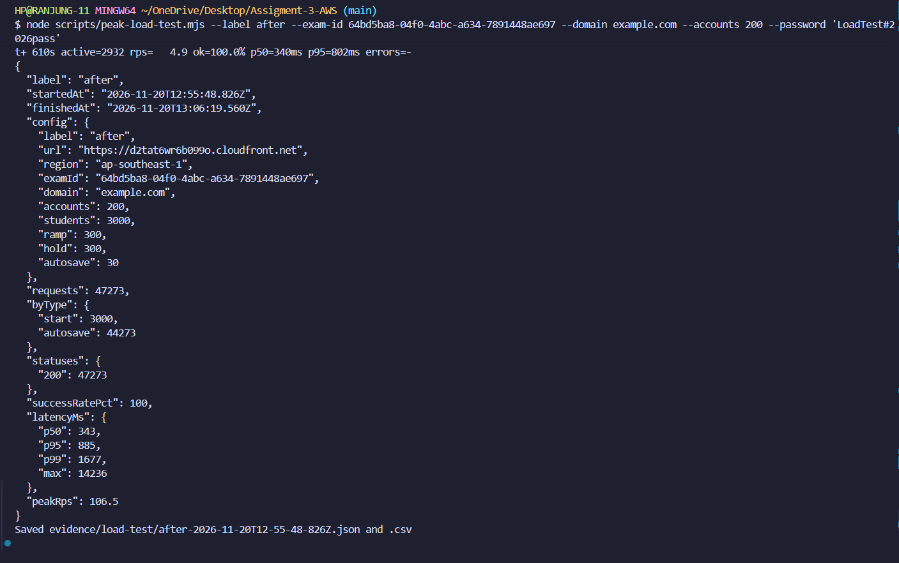

**Dashboard**

The whole CloudWatch dashboard during the re-test.

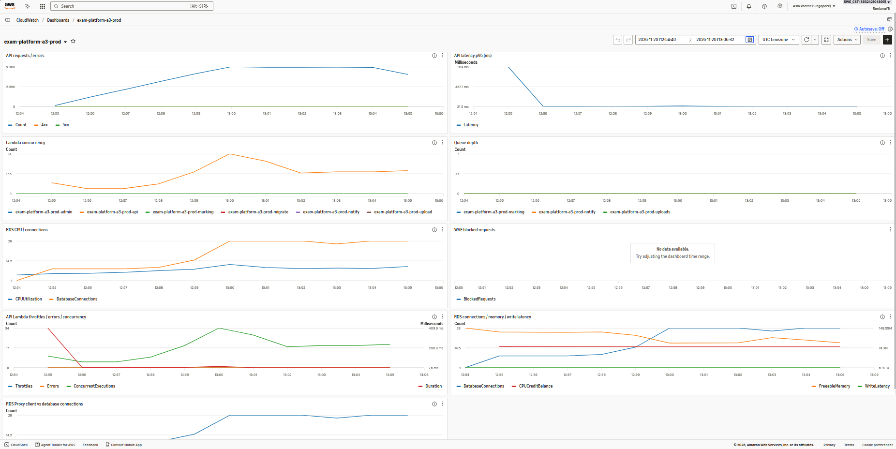

**Database and Lambda**

Database connections fell from 67 to 28, free memory rose to 92 MB, and there were no throttles.

**API requests and errors**

All requests reached the API, with zero errors.

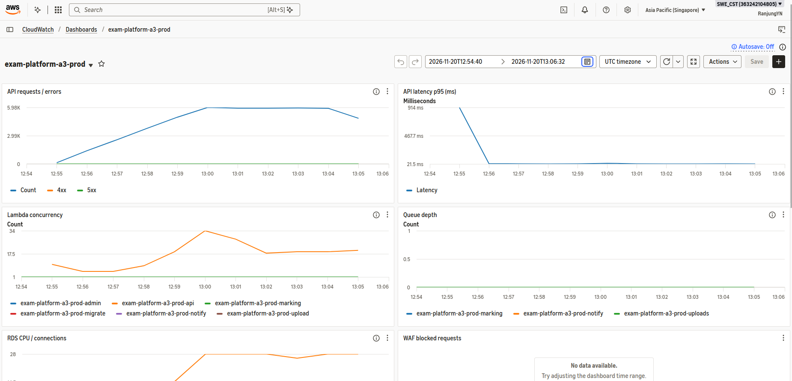

**WAF**

WAF blocked nothing this time.

---

## 7. Failure tests

Full explanation: [failure-test report](../infra/failure-tests/README.md). Raw output: [`failure-tests/`](failure-tests).

### FT1: losing the AZ that holds the database (RTO 66 s, RPO 0)

**Primary in AZ 1a before the test**

The database primary starts in `ap-southeast-1a`.

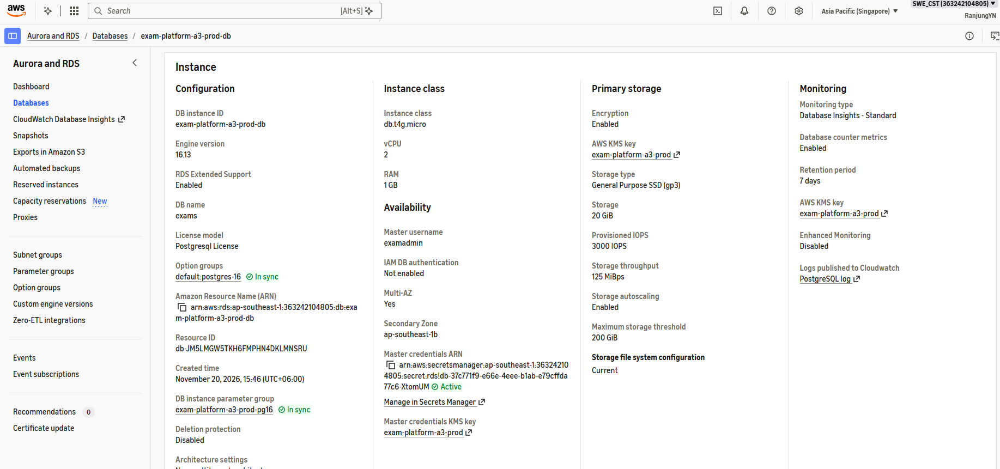

**Test output**

Only 4 of 64 health checks failed, the app was back within 66 s, and the saved answer was still there.

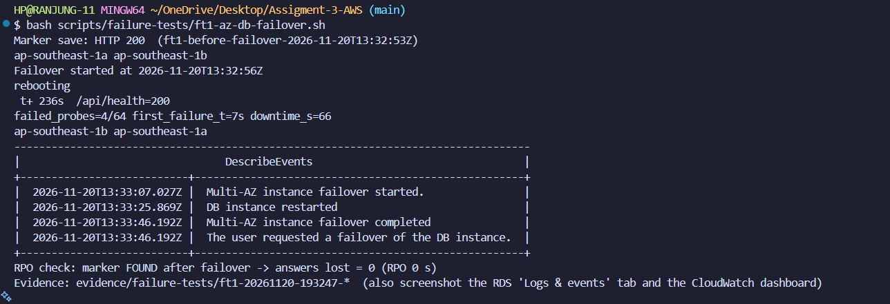

**Primary in AZ 1b after the test**

The primary moved to `ap-southeast-1b`, which shows the failover worked.

**RDS events**

AWS's own record of the failover, which took 39 seconds.

**Alarm email**

The team was emailed about the failover automatically.

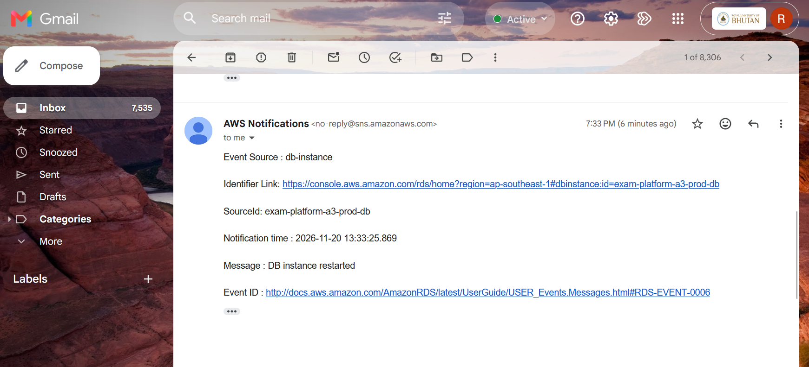

### FT2: restoring the database after bad data (RPO 154 s, RTO about 22 min)

**RPO reading**

The latest restore point was 154 s behind, so at most 154 s of data would be lost.

**Restored database**

The new copy of the database, restored to that point. It shows "Backing-up" because RDS takes a first backup straight after a restore.

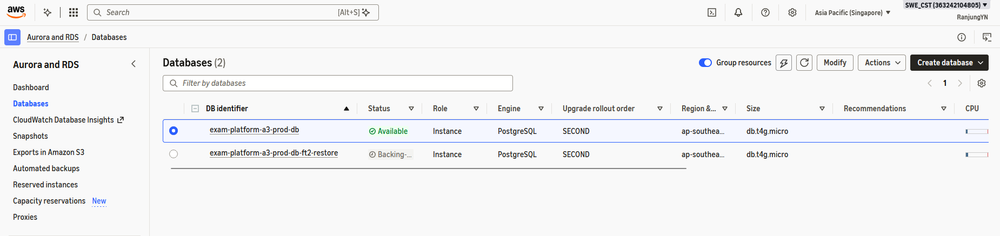

**Restore time**

The RDS events show the restore took 16.9 minutes, or about 22 minutes including the switch-over.

### FT3: losing the network of one AZ (recovered by itself in 120 s)

**Deny-all network ACL**

The AZ-a app subnet was cut off with a network ACL that blocks all traffic.

**Test output**

Requests failed for 120 s, then Lambda moved to the healthy AZ and everything worked, even with AZ-a still cut off.

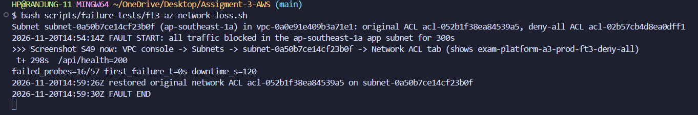

**Dashboard**

The errors on the dashboard during the first two minutes of the fault.

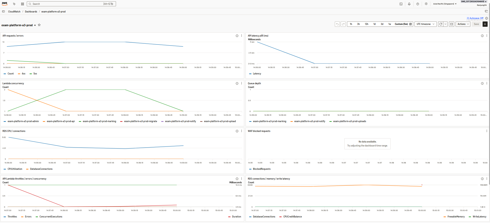

### FT4: a deleted file (recovered in 73 s, identical)

**S3 versions with the delete marker**

After the delete, S3 still keeps the original version under a "delete marker".

**File recovered**

The delete marker was removed, and the file came back with the same checksum: no data lost.

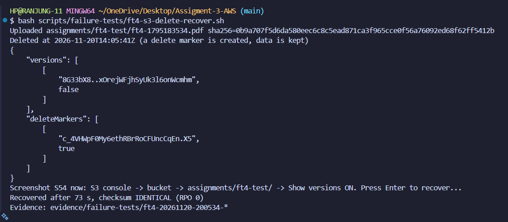

### FT5: the marking worker stopped (queue cleared in 96 s, nothing lost)

**Worker stopped**

The marking Lambda set to 0 concurrency, so it cannot run.

**Test output**

All 50 jobs waited safely in the queue, cleared in 96 s after the restart, and none reached the dead-letter queue.

**Queue depth**

The queue rises to 50 while the worker is stopped, then empties once it restarts.

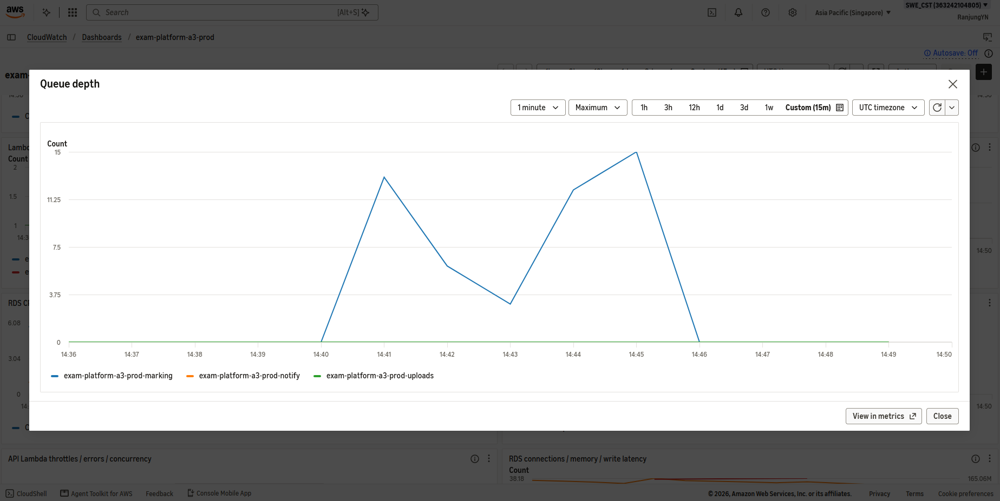

---

## 8. Tear down

**Tear-down workflow**

The GitHub Actions tear-down finished successfully and removed the stack.

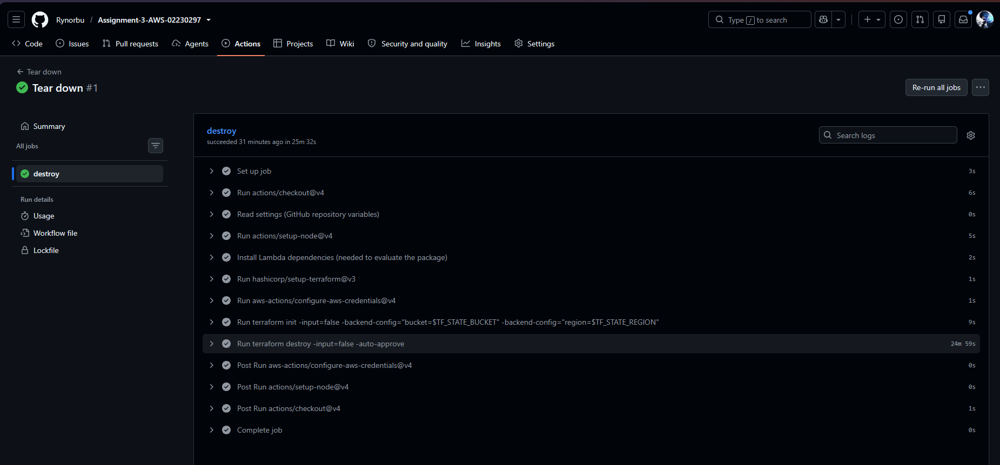

**Nothing left in the account**

A check after the tear-down shows no resources from this project are left running.

Cost Explorer was not available, because the class account gives students no Billing access. The cost of the test stack is estimated from its running time in the [cost report §10](../docs/cost-report.md#10-what-the-testing-itself-cost) (about $1.41).
