# Evidence

As agreed with the tutor, **these screenshots replace the demo video**.

- Every AWS console screenshot was taken in **Asia Pacific (Singapore)**. The exception is the WAF metrics, which AWS keeps in us-east-1.
- The raw output (CSV / JSON / text) sits next to the screenshots in each folder.

**Contents**
1. [Account and quotas](#1-account-and-quotas)
2. [Pricing Calculator](#2-pricing-calculator)
3. [Latency from Bhutan](#3-latency-from-bhutan)
4. [Architecture](#4-architecture)
5. [Deployment in Singapore](#5-deployment-in-singapore)
6. [Load test](#6-load-test)
7. [Failure tests](#7-failure-tests)
8. [Tear down](#8-tear-down)

---

## 1. Account and quotas

**AWS account**

**Region set to Singapore**

**Lambda quota: 1,000**

## 2. Pricing Calculator

Explained in the [cost report §8](../docs/cost-report.md#8-aws-pricing-calculator-check). Share links are in the [README](../README.md#2-reports).

| Estimate | Calculator total | Exports |
|---|---|---|
| Normal month | $268.85 / month + $668 upfront | [csv](calculator/normal-month.csv) · [pdf](calculator/normal-month.pdf) · [json](calculator/normal-month.json) |
| Exam month | $460.54 / month + $668 upfront | [csv](calculator/exam-month.csv) · [pdf](calculator/exam-month.pdf) · [json](calculator/exam-month.json) |
| A2 design in Singapore | $602.61 / month | [csv](calculator/a2-baseline.csv) · [pdf](calculator/a2-baseline.pdf) · [json](calculator/a2-baseline.json) |

**Normal month**

**Exam month**

**A2 design in Singapore**

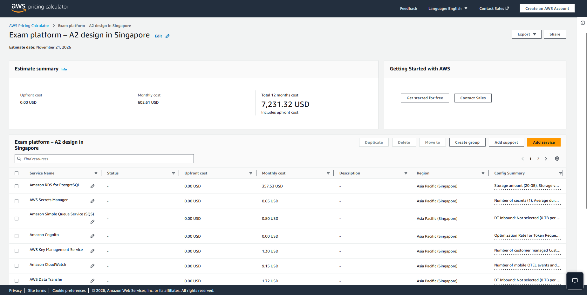

**Optimisation steps:**

**O1 NAT gateways back (+$67.46)**

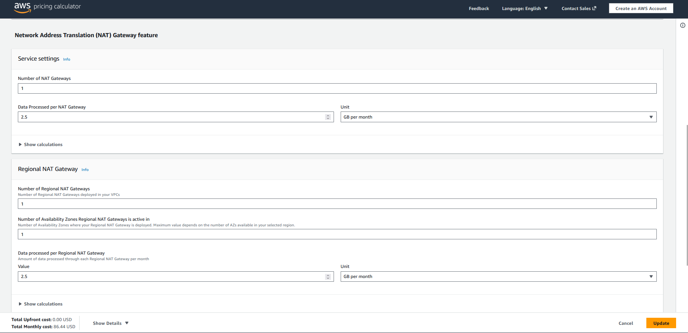

**O2 `m6g.large` (+$173.74)**

**O3 On-Demand (+$442.72 a year)**

**O4 all S3 Standard (+$152.83)**

**O5 logs: the calculator only supports 1-month retention**

## 3. Latency from Bhutan

Raw data: [`latency-20261120-1418.csv`](latency/latency-20261120-1418.csv). Median: Singapore **145 ms** · Hyderabad 155 ms · Mumbai 165 ms · N. Virginia 364 ms.

**`measure-latency.sh` (20 samples per Region)**

**cloudping.info**

## 4. Architecture

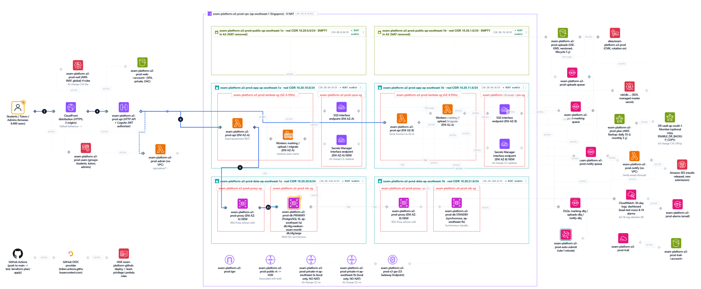

The simulator run of a student autosave: **13 steps, HTTP 200 in 160 ms.**

**Steps 1–4**

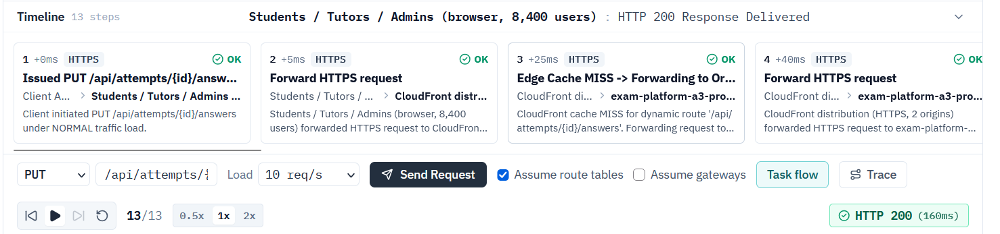

**Steps 5–8**

**Steps 9–12**

**Step 13**

## 5. Deployment in Singapore

**Bootstrap**

**GitHub variables**

**Pipeline green**

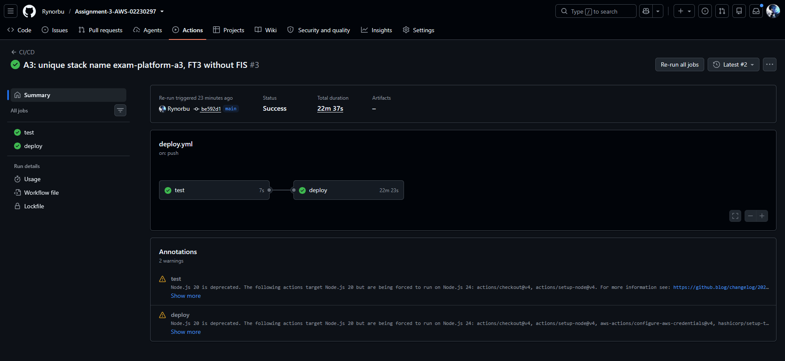

**Terraform init**

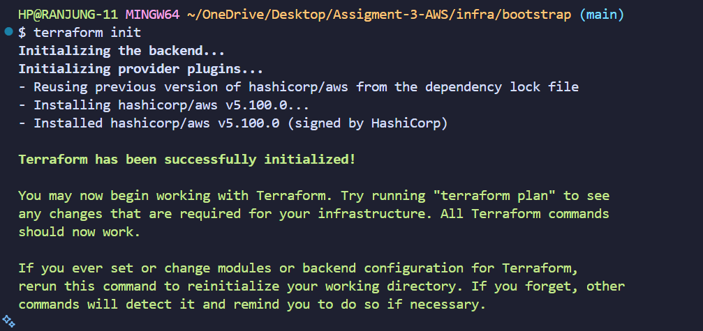

**Terraform apply**

**Terraform outputs**

**No NAT gateways**

**VPC endpoints**

**Subnets in 2 AZs**

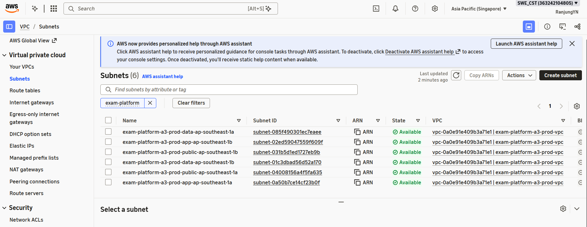

**RDS Multi-AZ**

**Lambda arm64**

**S3 lifecycle (5 years)**

**Backup plan**

**Daily rule (35 days)**

**Monthly rule (5 years)**

**CloudWatch dashboard**

**Alarm subscription**

**Alarm email**

**The app working:**

**Users created**

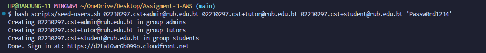

**Tutor created an exam**

**Student autosave**

**Answers kept after refresh**

## 6. Load test

Explained in the [load-test report](../docs/load-test.md). Raw output: [`load-test/`](load-test) and [`cloudwatch/`](cloudwatch).

**Before (WAF 20,000 per IP) — Script result**

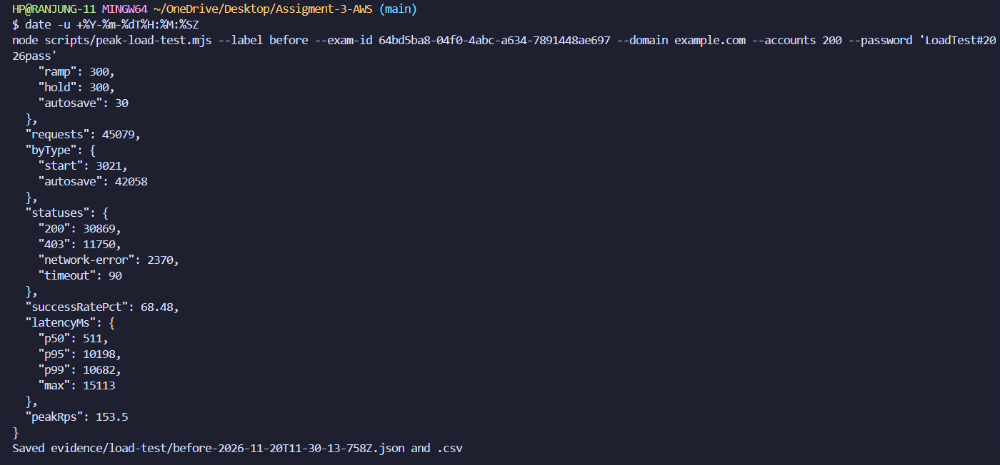

**After (fix applied) — Script result**

**Before (WAF 20,000 per IP) — Dashboard**

**After (fix applied) — Dashboard**

**Before (WAF 20,000 per IP) — Database and Lambda**

**After (fix applied) — Database and Lambda**

**Before (WAF 20,000 per IP) — API requests and errors**

**After (fix applied) — API requests and errors**

**Before (WAF 20,000 per IP) — WAF blocked requests**

**After (fix applied) — WAF blocked requests**

**The fix:**

**Variables changed**

**Free plan refused a bigger database**

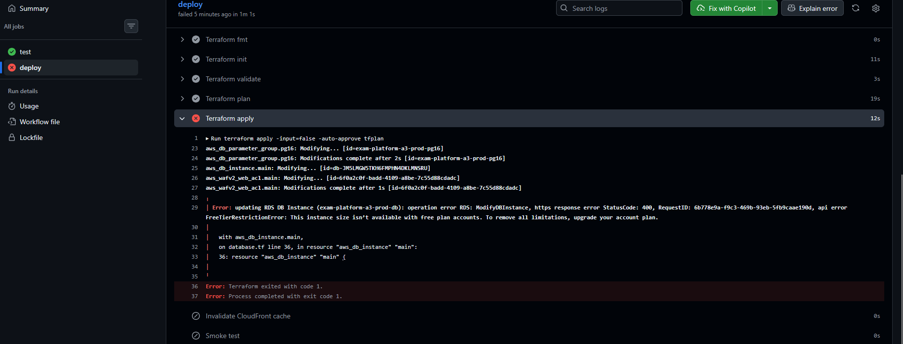

**WAF rules after the fix**

**API concurrency cap = 40**

## 7. Failure tests

Explained in the [failure-test report](../infra/failure-tests/README.md). Raw output: [`failure-tests/`](failure-tests).

**FT1: losing the database AZ** (RTO 66 s, RPO 0)

**Primary in 1a**

**Test output**

**Primary in 1b**

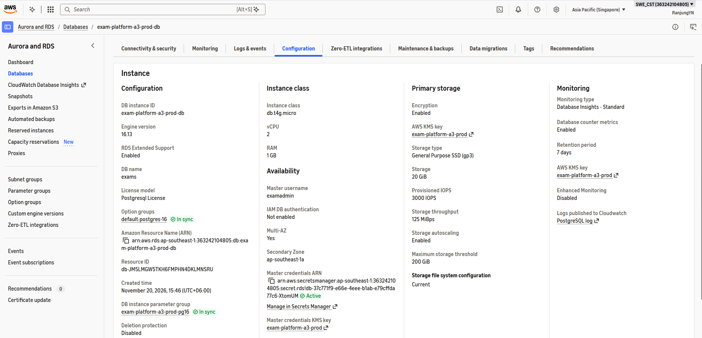

**RDS events**

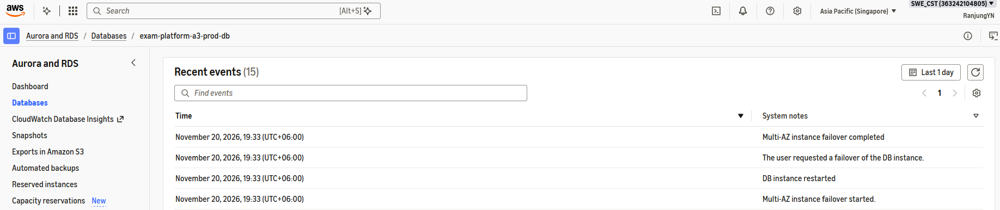

**Alarm email**

**FT2: point-in-time restore** (RPO 154 s, RTO ≈ 22 min)

**RPO reading**

**Restored database**

**Restore time**

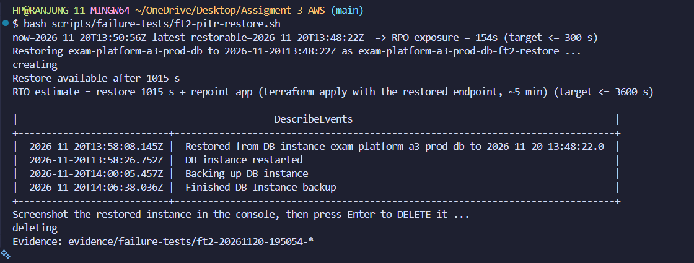

**FT3: losing the network of one AZ** (healed itself in 120 s)

**Deny-all ACL**

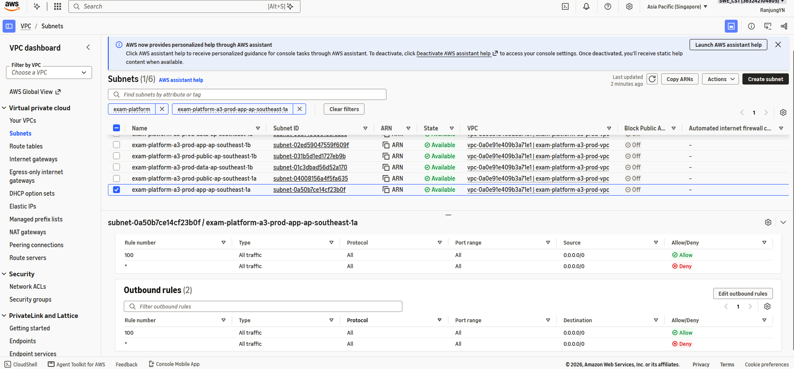

**Test output**

**Dashboard**

**FT4: deleted file** (recovered in 73 s, identical)

**Versions with the delete marker**

**Recovered**

**FT5: marking worker stopped** (backlog cleared in 96 s, 0 lost)

**Worker stopped**

**Test output**

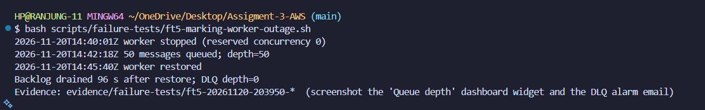

**Queue depth**

## 8. Tear down

**Tear-down workflow**

**Nothing left in the account**

Cost Explorer was not available, because the class account gives students no Billing access. The cost of the test stack is estimated from its running time in the [cost report §10](../docs/cost-report.md#10-what-the-testing-itself-cost) (≈ $1.41).
