# Failure Tests

**Targets:** RPO ≤ 5 minutes · RTO ≤ 1 hour · survive the loss of one Availability Zone

Five failures were caused on purpose against the real stack in Singapore on 2026-11-20, and each was measured. A sixth (losing the whole Region) was worked through as a tabletop exercise. For each test the report shows:
- **Expected:** what the design predicts *before* the test.
- **Measured:** what actually happened.
- **Fix:** how to make it better.

Scripts: [`scripts/failure-tests/`](../../scripts/failure-tests). Raw output and screenshots: [`evidence/failure-tests/`](../../evidence/failure-tests).

## Results at a glance

| # | What fails | How it was caused | RPO (≤ 5 min) | RTO (≤ 1 h) | Pass |
|---|---|---|---|---|---|
| FT1 | The AZ hosting the primary database | Forced Multi-AZ failover | **0 s** | **66 s** | ✅ |
| FT2 | Answers wiped by a bad change | Point-in-time restore | **154 s** | **≈ 22 min** | ✅ |
| FT3 | The network of one AZ | Deny-all network ACL on the AZ-a subnet | **0 s** | **120 s** (healed itself) | ✅ |
| FT4 | A submitted file is deleted | `aws s3 rm` on a versioned file | **0 s** | **73 s** | ✅ |
| FT5 | The marking worker stops | Lambda concurrency set to 0 | **0 s** | **96 s** to clear the backlog | ✅ |
| FT6 | The whole Singapore Region | Tabletop exercise only | ≤ 24 h | 2–4 h | ⚠️ accepted risk |

---

## FT1: Losing the AZ that hosts the primary database

**What the test does:** saves a marker answer, forces the database to fail over to the other AZ, checks `/api/health` every 2 seconds for 4 minutes, then reads the marker back.

**Expected:** RDS promotes the standby in the other AZ. Without RDS Proxy, the API fails for about **60–120 s** while Lambdas reconnect. Students see "Offline – kept on this device", and their answers are re-sent on the next autosave.

**Measured** (13:33 UTC, `db.t4g.micro`, no RDS Proxy):

| Measure | Expected | Measured |
|---|---|---|
| Database failover time | 60–120 s | **39 s** |
| Impact on the API (first error → stable) | 60–120 s | **66 s**: only 4 of 64 checks failed |
| Answer kept (RPO) | yes | ✅ **marker found, 0 answers lost** |
| Primary AZ | 1a → 1b | ✅ **ap-southeast-1a → ap-southeast-1b** |

**Result: ✅ pass.** RTO 66 s and RPO 0. It recovered faster than expected because the API retries a broken database connection once.

**Fix:** turn on RDS Proxy (production), which keeps connections open during a failover. The failover alarm email arrived as expected.

**Primary in 1a before**

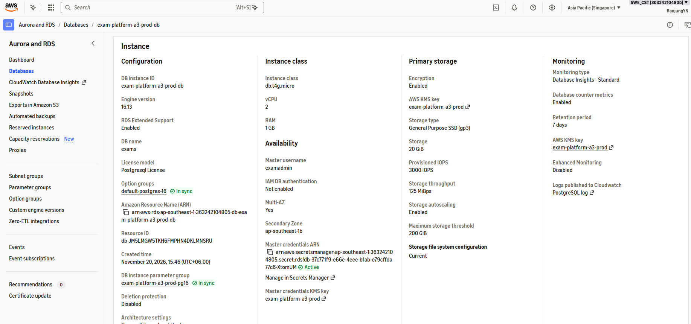

**Test output**

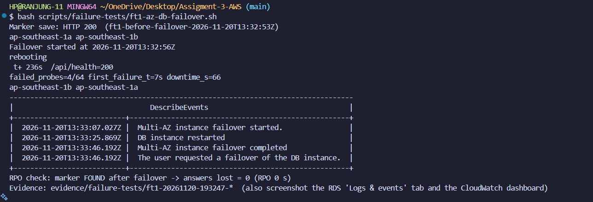

**Primary in 1b after**

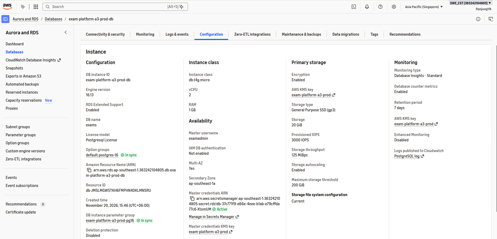

**RDS events**

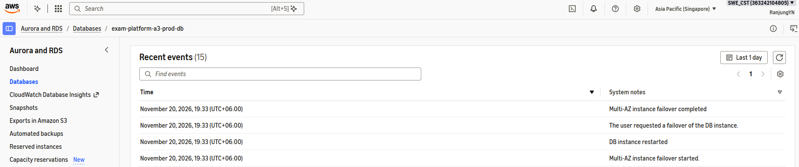

**Alarm email**

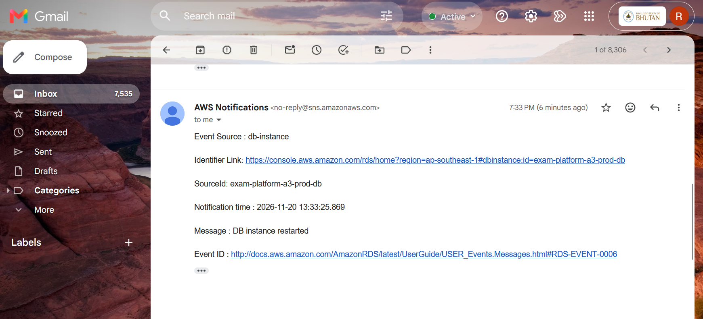

---

## FT2: Data wiped by a bad change (point-in-time restore)

**Why it matters:** Multi-AZ does **not** help here, because the standby copies the bad change too. Only a backup can undo it.

**What the test does:** reads how far behind the latest restore point is (that is the RPO), restores a new database from that point and times it, then deletes the copy.

**Expected:** RPO 1–5 min, because RDS saves its logs every 5 minutes. Restore about 10–25 min, plus about 5 min to switch the app over.

**Measured:**

| Measure | Expected | Measured |
|---|---|---|
| RPO (data that would be lost) | 60–300 s | **154 s** ✅ (3 readings: 165 s, 154 s, 308 s ⚠️) |
| Restore time | 10–25 min | **16.9 min** |
| Total RTO (restore + switch-over) | 15–35 min | **≈ 22 min** ✅ |

**Result: ✅ pass, with RPO at the edge.**
- RDS saves its logs every 5 minutes, so the restore point can lag by up to just over 5 minutes. One reading was 8 s over the target.
- **For students the real loss is about 0**, because the browser keeps every answer and re-sends it on the next 30-second autosave.

**Fix:**
1. The runbook renames the broken database and gives the restored one its name, so the app needs no change.
2. If a strict 5-minute database RPO is required, move to Aurora, whose restore point is about 1 s behind.

```bash
aws rds modify-db-instance --db-instance-identifier exam-platform-a3-prod-db --new-db-instance-identifier exam-platform-a3-prod-db-broken --apply-immediately
aws rds modify-db-instance --db-instance-identifier exam-platform-a3-prod-db-ft2-restore --new-db-instance-identifier exam-platform-a3-prod-db --apply-immediately
```

**RPO reading**

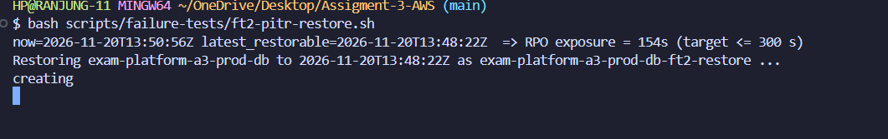

**Restored database**

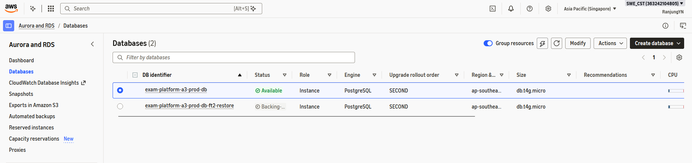

**Restore time (RDS events)**

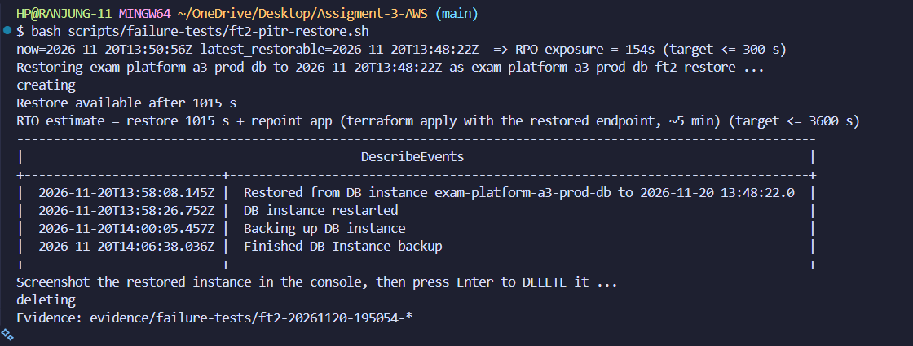

The restored database shows *Backing-up* because RDS takes its first backup straight after a restore. It was already usable.

---

## FT3: Losing the network of one AZ

**How:** the AZ-a app subnet was moved to a network ACL that blocks all traffic, for 5 minutes, then put back. AWS Fault Injection Service would do the same, but it is blocked on the Free plan account (`SubscriptionRequiredException`). The script always restores the original ACL, even if it is interrupted.

**Expected:** Lambda does not check whether its subnet works. Copies of the function in the broken subnet would time out, so about **20–50 % of requests would fail** for the whole 5 minutes.

**Measured** (fault 14:54–14:59 UTC):

| Measure | Expected | Measured |
|---|---|---|
| Failed checks during the fault | 20–50 %, all the time | **16 of 57 (28 %), all in the first 2 minutes.** Then **100 % success while the subnet was still blocked.** |
| User-visible outage | — | **120 s** ✅ |
| Recovery after the ACL was restored | < 30 s | **immediate** ✅ |
| Answers lost | 0 | **0** ✅ (autosave retried 4 times in 120 s) |

**Result: ✅ pass, and better than predicted.** At low traffic the few running Lambdas happened to be in the broken AZ, so everything failed at first. After about 2 minutes Lambda replaced them with new copies in the healthy AZ, and everything worked again **without any manual action**.

**Fix (to make the 120 s shorter):**
1. Lower the API Lambda timeout from 15 s to 6 s, so broken copies are replaced sooner.
2. If an AZ stays broken, remove it with `lambda_subnet_indexes = [1]` (2–4 minutes).
3. Keep the API 5xx alarm.

**Deny-all ACL on the AZ-a subnet**

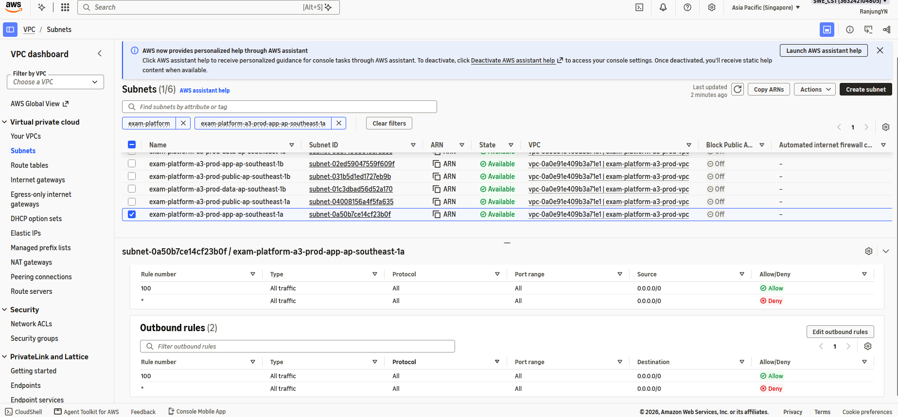

**Test output**

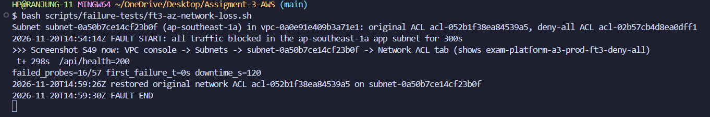

**Errors on the dashboard**

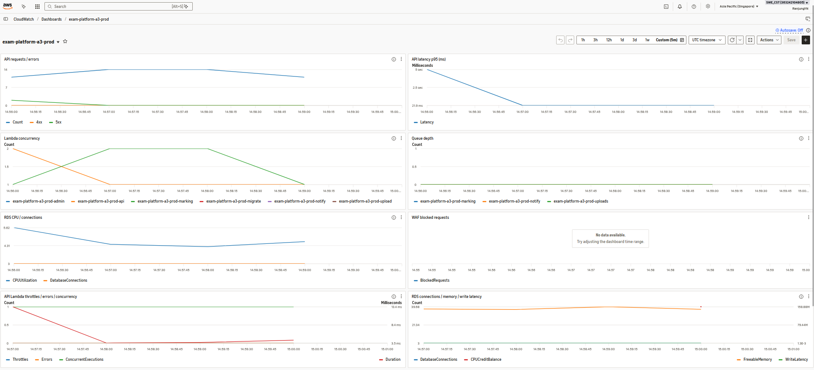

---

## FT4: A submitted file is deleted

**What the test does:** uploads a 2 MB test file, deletes it, brings it back by removing the S3 "delete marker", and compares checksums.

**Expected:** no impact. Versioning keeps the file, and it comes back in seconds.

**Measured** (14:05 UTC):

| Measure | Expected | Measured |
|---|---|---|
| Time to recover | < 10 s | **73 s** ✅ (mostly the AWS CLI starting up on Windows; the S3 action itself is instant) |
| File identical (RPO) | yes | ✅ **same SHA-256 checksum, 0 bytes lost** |

**Result: ✅ pass.**

**Fix:**
- Old versions are kept for only **30 days**, so a deletion noticed later cannot be undone. Raise this to 90 days.
- Add **S3 Object Lock** for legal holds.
- Allow only an admin role to delete files.

**Versions with the delete marker**

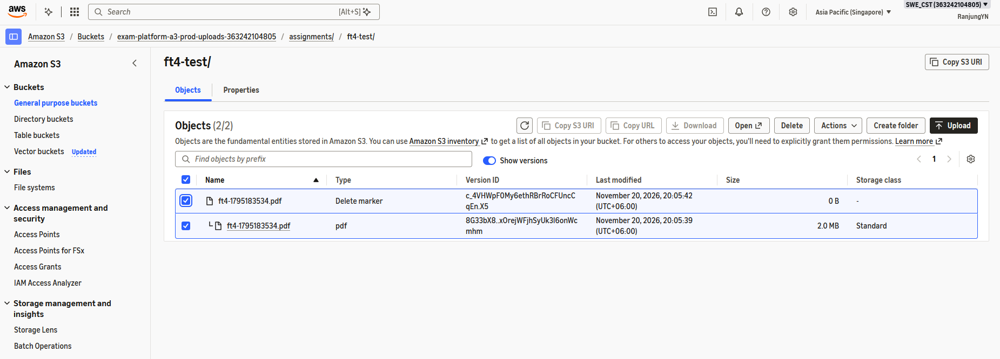

**Recovered, checksum identical**

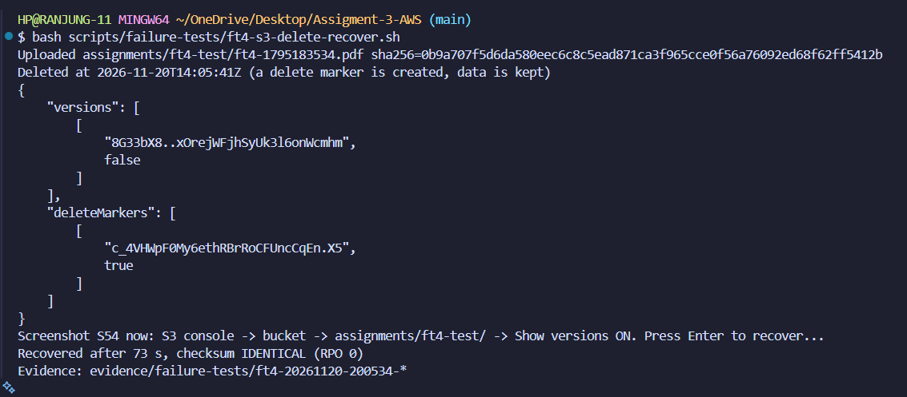

---

## FT5: The marking worker stops while submissions arrive

**What the test does:** stops the marking Lambda (concurrency 0), queues 50 marking jobs, restarts the worker, and measures how long the queue takes to empty.

**Expected:** students can still submit, because the API only queues the work. Marking is delayed, and SQS keeps the jobs for 4 days. Some jobs might reach the dead-letter queue.

**Measured** (14:40–14:47 UTC):

| Measure | Expected | Measured |
|---|---|---|
| Worker outage | 3 min | 5 min 39 s |
| Jobs waiting in the queue | 50 | **50**, all kept |
| Jobs lost | 0 | **0** ✅ |
| Time to empty the queue after restart | < 60 s | **96 s** ✅ (50 → 28 → 16 → 6 → 0) |
| Jobs in the dead-letter queue | 0–50 | **0** ✅ |

**Result: ✅ pass.** SQS kept every job. When the worker came back, the backlog cleared by itself in 96 s. A marking outage only delays results; no submission is lost.

**Fix:** to pause a worker, disable its queue trigger instead of setting concurrency to 0, and raise `maxReceiveCount` from 5 to 10.

**Worker stopped**

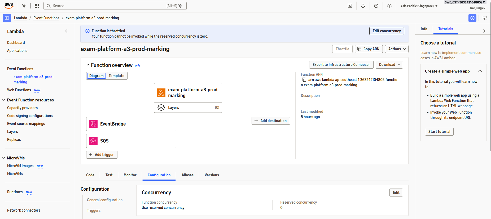

**Test output**

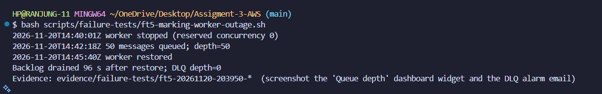

**Queue rises to 50, then empties**

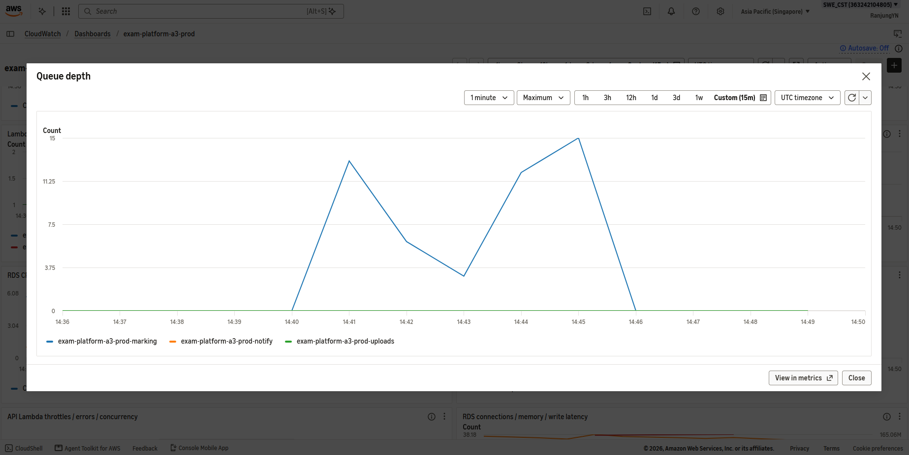

---

## FT6: Losing the whole Singapore Region (tabletop exercise)

**Expected:** the whole platform is down. Multi-AZ does not help, because both AZs are in the Region.

| Option | RPO | RTO | Extra cost |
|---|---|---|---|
| Accept the risk (default) | up to 24 h | days | $0 |
| **Copy backups to Mumbai** (`ENABLE_DR_BACKUP_COPY=true`) and redeploy there with Terraform | ≤ 24 h | **2–4 h** | ≈ $3–5 / month |
| Warm standby in a second Region | < 1 min | < 1 h | + $150–300 / month |

**Decision:** accept the risk, and turn on the Mumbai backup copy before exam months. A full Singapore outage is rare. A warm standby would double the database bill. The 1-hour RTO is **not** met for Region loss; the [feasibility verdict](../../docs/cost-report.md#9-feasibility-verdict) states this openly.
